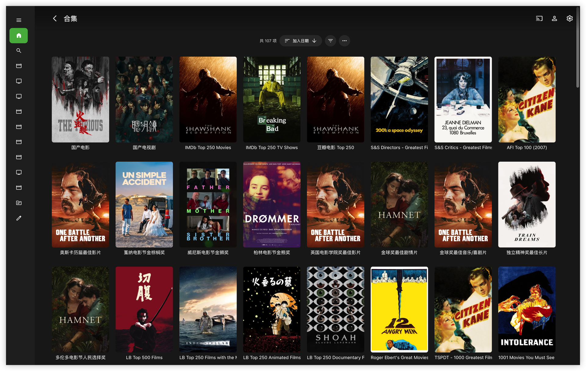

# Emby Collection Sync

[简体中文](README.md) | [繁體中文](README.zh-TW.md) | **English**

Synchronize TMDb lists into Emby collections, report missing titles, optionally subscribe through MoviePilot, organize media by country, and upload original-language posters. Runs in Qinglong or directly with Python.

## 🎬 Use with Emby Companion

[Emby Companion](https://github.com/ffinly/emby-companion) is a macOS viewing companion for discovering titles through curated lists, checking library availability and missing episodes, submitting subscriptions manually, and watching with a local player. The app uses this project’s preset lists, while the script maintains collections on your Emby server on a schedule. They can be used independently or together.

## ✨ Core Features

- **🏆 Automated list sync**: 157 bundled IMDb, Douban, Letterboxd, TMDb, and other lists, plus custom TMDb lists, descriptions, and missing-title reports.
- **📌 Daily rebuild ordering**: preserve creation order so new collections appear ahead of older collections when Emby sorts by date added, descending. Complete and verify replacements before deleting old collections.
- **🌏 Country collections**: `CN` groups mainland China, Hong Kong, Taiwan, and Macao by default. Add other codes as needed; omitting `CN` skips Chinese collections, and an empty list disables country collections.
- **🌐 One script, three languages**: deploy only `emby_collection_sync.py`, with common settings at the top and built-in Simplified Chinese, Traditional Chinese, and English logs, notifications, and list names.
- **⭐ Favorite exclusions by username**: automatic favorites are enabled by default, with exact Emby username exclusions and a global switch.
- **🍿 MoviePilot subscriptions**: all missing titles, top N only, or report-only policies; separate movie/TV exclusions and season-specific TV checks.
- **🖼️ Posters and reports**: original-language posters, missing-image repairs, missing-title details, and subscription/repair totals, with caching, pagination validation, connection checks, and credential redaction.

## 📸 Showcase



*Emby collection poster wall and categories.*

## 🚀 Quick Start (via Qinglong Panel)

Requires **Python 3.9+**, an accessible Emby server, and a TMDb API key. MoviePilot is optional.

1. Place [emby_collection_sync.py](emby_collection_sync.py) under Qinglong's `scripts`. No separate Python configuration file is required.
2. Install `requests` and `urllib3` under Qinglong's Python3 dependencies.
3. Add `EMBY_URL`, `EMBY_API_KEY`, and `TMDB_API_KEY` as environment variables. See [Connections](#connections-environment-variables-by-default) for values and optional settings.
4. Edit language, country codes, favorite exclusions, and other settings at the top of the script, plus the list subscription policies below. The synchronization logic needs no edits.
5. Run `task emby_collection_sync.py` to synchronize collections and apply configured favorites, subscriptions, and notifications.
6. Schedule once daily. Standard five-field cron: `30 8 * * *` (08:30). For a panel expecting a leading seconds field, use `0 30 8 * * *`. The scheduler's configured timezone applies.

Notifications use Qinglong's `notify.send`. Without that module, the report prints to the console; do not install an unrelated package named `notify`.

### Script structure and translations

| Script section | Contents |
| --- | --- |
| Common settings at the top | Language, countries, favorite exclusions, connections, proxy, and poster policies |
| List settings | Core lists, Douban categories, historical names, and icons |
| Translation data | List names, log and notification messages, and country/region names |
| Synchronization logic | API calls, daily rebuilds, subscriptions, favorites, and notifications |

Common settings appear first, followed by lists, translations, and synchronization logic. `LIST_NAMES` maps list IDs to `zh-CN`, `zh-TW`, and `en` names. `MESSAGES` maps English message keys to `zh-CN`, `zh-TW`, and `en` translations. `COUNTRY_LABELS` holds country/region names in all three languages, `COUNTRY_ALIASES` adds alternate names, and `COUNTRY_LEGACY_LABELS` preserves previous translations for collection renaming. Preserve placeholders such as `{name}` when editing messages. To switch language, change only `LANGUAGE`.

The introduction and configuration comments include all three languages. Synchronization code and comments use English; displayed messages come from the built-in translation tables.

Schedule only `emby_collection_sync.py`. Before updating the script, back up and merge your own settings and list policies.

### Common settings at the top of the script

Configuration comments include Simplified Chinese, Traditional Chinese, and English; logs and notifications use only the selected `LANGUAGE`.

```python
LANGUAGE = "en"                        # zh-CN / zh-TW / en; shipped default: zh-CN
COUNTRY_CODES = ["CN"]                  # CN groups CN/HK/TW/MO; [] disables country collections
FAVORITES_ENABLE = True
FAVORITES_EXCLUDE_USERS = ["kids"]       # exact Emby usernames, case-sensitive
MP_ENABLE = False                      # requires MP_URL and MP_API_TOKEN when enabled
USE_PROXY = False                      # requires PROXY_URL when enabled
EMBY_VERIFY_SSL = True                  # verify Emby HTTPS; False allows self-signed certificates
MP_VERIFY_SSL = True                    # verify MoviePilot HTTPS; False allows self-signed certificates
LIST_POSTER_MODE = "library"            # first local match / first list entry
DOMESTIC_POSTER_MODE = "premiere"       # latest release / latest library addition
POSTER_SIZE = "w780"                    # w780 / original
COUNTRY_CACHE_DAYS = 90                 # country-cache lifetime in days; must be positive
```

`kids` is an example; the shipped exclusion list is empty. Use actual Emby usernames, not IDs. Excluded users receive no automatic favorites, and existing favorites are not explicitly cleared. Rebuilding changes collection IDs; personal favorite states on deleted collections are not migrated. These settings do not control content access; configure child-account permissions in Emby.

`LANGUAGE` controls logs, notifications, bundled list names, and country collection names. TMDb title translations depend on availability. Custom list names and external API error messages remain unchanged.

### Connections (environment variables by default)

Connections read environment variables by default. To supply a literal value, replace the corresponding assignment using the commented example in the script. A literal value takes precedence for that setting; unchanged settings still read the environment:

```python
MP_URL = os.getenv("MP_URL")
# MP_URL = "http://192.168.1.10:3000"
MP_API_TOKEN = os.getenv("MP_API_TOKEN")
# MP_API_TOKEN = "your-mp-api-token"
```

The literal examples remain comments and are inactive by default. Emby, TMDb, MoviePilot, proxy, and TMDb v4 token settings all support this pattern. The `EMBY_SYNC_CACHE` environment variable selects the country-cache path.

| Variable | Required when | Description |
| --- | --- | --- |
| `EMBY_URL` | Always | Server root, e.g. `http://192.168.1.100:8096`; do not append `/emby` |
| `EMBY_API_KEY` | Always | Emby API key |
| `TMDB_API_KEY` | Always | TMDb v3 API key |
| `MP_URL` | `MP_ENABLE = True` | MoviePilot service URL |
| `MP_API_TOKEN` | `MP_ENABLE = True` | MoviePilot API token |
| `PROXY_URL` | `USE_PROXY = True` | HTTP(S) proxy for TMDb API and image requests |
| `TMDB_ACCESS_TOKEN` | Optional | TMDb API Read Access Token for v4 fallback after a v3 list returns 404; private lists require an authorized user token |
| `EMBY_SYNC_CACHE` | Optional | Absolute country-cache path; defaults to `.emby_country_cache.json` beside the script |

Configuration is validated before connecting. HTTPS verification is on by default. Disabling Emby or MoviePilot verification never disables verification for TMDb or poster downloads.

### Country collections

- The default `COUNTRY_CODES = ["CN"]` creates Chinese Movies and Chinese TV Shows when `LANGUAGE = "en"`. **In this script, `CN` is a combined group covering mainland China, Hong Kong, Taiwan, and Macao, matching TMDb codes `CN/HK/TW/MO`**, rather than only TMDb's individual `CN` code.
- Omit `CN` to skip Chinese collections. `["JP", "US"]` creates only Japanese and US movie/TV collections; `[]` disables all country collections while ordinary list synchronization continues. No separate switch is needed.
- `HK`, `TW`, and `MO` can also be selected individually. If selected alongside `CN`, a title can appear in both the combined and individual collections.
- All country/region collections use TMDb country codes: movies, including those in the CN group, use `production_countries`; TV shows use `origin_country`. Co-productions may appear in several collections. This classifies production origin, not spoken language.
- 272 countries/regions have complete offline translations, including historical codes such as `SU` (Soviet Union) and `XC` (Czechoslovakia). `NZ` displays as 新西兰 / 紐西蘭 / New Zealand. Country names require no extra network lookups.
- Configuration accepts codes and recognized aliases/names: `UK` becomes `GB`, `USA` becomes `US`, and `USSR` becomes `SU`. Leading/trailing spaces and case are ignored; equivalent selections are deduplicated. Codes are recommended. Names resolving to `CN` still select the combined four-region group described above. Unknown selections fail validation before connecting rather than using fuzzy guesses.
- Previous translations and code-only collection names are retained as migration aliases, so a collection such as `NZ Movies` can be replaced by `New Zealand Movies` without leaving duplicates after a successful rebuild.
- TMDb country results are cached for 90 days by default, configurable with `COUNTRY_CACHE_DAYS`; valid cached results are reused and refreshed after expiry. A 404 (entry not found) skips only that title’s country classification and clears its old country cache, allowing other titles to continue; it does not modify the movie or TV show in the Emby library. The next run retries the lookup. Timeouts, rate limits, and other lookup failures use historical cache data when available; without it, existing country collections for that media type are preserved. Titles missing a TMDb ID are logged and skipped for country classification.

Removing CN, another country, or a list stops future creation/rebuilding for it; existing collections are not automatically deleted.

### Lists and MoviePilot

`CUSTOM_LISTS`, `DOUBAN_GENRE_LISTS`, and `DOUBAN_TV_LISTS` are editable in `emby_collection_sync.py`. Remove unwanted entries or add your own TMDb lists to the appropriate array. Use the number after `/list/` in the TMDb URL as `id`, not the full URL. The `123456` below is only a format example; replace it with your list ID:

```python
{"name": "My list", "id": "123456", "type": "Movie",
 "mp_subscribe": 3, "notify_missing": True}
```

`type` is `Movie` (default) or `Series`. `mp_subscribe` accepts `True` (all missing titles), `False` (report only), or a positive integer N (only missing titles ranked in the top N; `0` acts like `False`). Actual subscriptions require `MP_ENABLE = True`. `notify_missing` controls missing-title details for core lists; category lists retain compact totals.

Movie and TV exclusion IDs are configured separately through `MP_EXCLUDE_MOVIE_IDS` and `MP_EXCLUDE_SERIES_IDS`; numeric and string IDs both work. TV subscriptions remain season-specific, with season 0 representing specials. Failed duplicate checks stop the affected subscription flow.

## 📌 Daily rebuild and ordering

Execution follows category lists → core lists → country collections. Category lists and core lists are each created in reverse order. Country collections process TV first, then movies, with country codes in reverse configuration order within each media type. Select **date added, descending** in Emby to put this newly created group ahead of older unrelated collections. If another collection is created later, the next run restores the ordering.

A temporary replacement is created, filled, verified, and renamed before the old collection is removed. Creation, membership, or verification failures preserve the old collection. Every successful rebuild creates a new collection ID and generates its poster according to the configured policy.

**Targets are identified by configured and historical names**. Reserve these names for the script: manually created collections with the same names are also synchronization targets. Bundled names in previous languages are recognized when switching language. Do not overlap two runs. Forced interruption can leave a temporary collection containing `[sync-...]` in its name; inspect it before manual cleanup.

Failed or incomplete TMDb lists cause no rebuild or subscriptions from partial data. Empty lists and fewer than two local matches preserve existing list collections. Country collections require at least one local match. Match counts determine whether a collection is rebuilt; they do not disable subscriptions for missing titles in a complete list. Unrelated differently named collections are not rebuilt, but the missing-poster repair step still checks them.

## 🖼️ Posters and reports

List posters use either the first ranked title or first locally available title. Country collections sort by latest release or library addition and use the first title with an available poster. Collection posters prefer the original language, falling back to other available TMDb posters when necessary. Movie and TV missing-image repair requires an original-language poster and leaves existing primary images alone. Queued uploads execute **sequentially** after collection processing, not asynchronously.

The default image size is `w780`; select `original` if desired. Old images are kept until upload. Reports include core-list details, compact category counts, the first three missing titles, subscriptions, and poster statistics, with a failed/skipped collection list. Category counts indicate collections meeting the match threshold, not successful rebuilds; rebuild failures are listed separately.

## 🐍 Run without Qinglong

Download [emby_collection_sync.py](emby_collection_sync.py) and [requirements.txt](requirements.txt) into the same directory. Open a terminal in that directory and run these commands on Linux/macOS:

```bash
python3 -m venv .venv
source .venv/bin/activate
python3 -m pip install -r requirements.txt
export EMBY_URL="http://192.168.1.100:8096"
export EMBY_API_KEY="YOUR_EMBY_KEY"
export TMDB_API_KEY="YOUR_TMDB_KEY"
python3 emby_collection_sync.py
```

Provide the same environment in your scheduler and use the virtual environment's absolute Python path. Credentials and URL authentication information are redacted in script logs.

## 🔗 Publicly Maintained TMDb Lists

The following TMDb lists are fully maintained by automated crawlers and ETL pipelines. **Data fetching, comparison, and synchronization run daily at 07:30 (UTC+8)** to ensure rankings remain perfectly aligned with official sources.

### 🏆 Tier 1: Mainstream Essentials

* 🍿 **IMDb Top 250 Movies**: [View Grid](https://www.themoviedb.org/list/8647021?view=grid)
* 📺 **IMDb Top 250 TV Shows**: [View Grid](https://www.themoviedb.org/list/8647022?view=grid)
* 🎞️ **Douban Movies Top 250**: [View Grid](https://www.themoviedb.org/list/8647023?view=grid)

### 🏛️ Tier 2: Cinematic Hall of Fame

* 🏛️ **S&S Directors - Greatest Films**: [View Grid](https://www.themoviedb.org/list/8649058?view=grid)
* 🏛️ **S&S Critics - Greatest Films**: [View Grid](https://www.themoviedb.org/list/8649050?view=grid)
* ⭐ **AFI Top 100 (2007)**: [View Grid](https://www.themoviedb.org/list/8649041?view=grid)
* 🎓 **Harvard Film PhD Program**: [View Grid](https://www.themoviedb.org/list/8714340?view=grid)
* 📰 **NYT - 100 Best Movies of the 21st Century (2025)**: [View Grid](https://www.themoviedb.org/list/8701141?view=grid)
* 📡 **NYT - 100 Best TV Shows of the 21st Century (2026)**: [View Grid](https://www.themoviedb.org/list/8701142?view=grid)

### 🌍 Tier 3: Global Prestigious Film Awards

* 🏆 **Oscar Winning Films: Best Picture**: [View Grid](https://www.themoviedb.org/list/8648843?view=grid)
* 🌿 **Cannes Film Festival Palme d'Or**: [View Grid](https://www.themoviedb.org/list/8648844?view=grid)
* 🦁 **Venice Film Festival Golden Lion**: [View Grid](https://www.themoviedb.org/list/8648854?view=grid)
* 🐻 **Berlinale Film Festival Golden Bear**: [View Grid](https://www.themoviedb.org/list/8648852?view=grid)
* 🎭 **BAFTA Award for Best Film**: [View Grid](https://www.themoviedb.org/list/8648848?view=grid)
* 🌐 **Golden Globe Best Drama**: [View Grid](https://www.themoviedb.org/list/8648849?view=grid)
* 🥂 **Golden Globe Best Musical/Comedy**: [View Grid](https://www.themoviedb.org/list/8648850?view=grid)
* 🍁 **Toronto Film Festival Audience Award**: [View Grid](https://www.themoviedb.org/list/8648855?view=grid)
* 🕊️ **Indie Spirit Award for Best Feature**: [View Grid](https://www.themoviedb.org/list/8648851?view=grid)

### 🎬 Tier 4: Cinephile Communities & Curations

* 🎬 **LB Top 500 Films**: [View Grid](https://www.themoviedb.org/list/8648802?view=grid)
* 🔥 **LB Top 250 Films with the Most Fans**: [View Grid](https://www.themoviedb.org/list/8649224?view=grid)
* 💥 **LB Top 250 Action Films**: [View Grid](https://www.themoviedb.org/list/8714314?view=grid)
* 🎨 **LB Top 250 Animated Films**: [View Grid](https://www.themoviedb.org/list/8649225?view=grid)
* 📖 **LB Top 250 Biographical Films**: [View Grid](https://www.themoviedb.org/list/8714315?view=grid)
* 🚔 **LB Top 250 Crime Films**: [View Grid](https://www.themoviedb.org/list/8714316?view=grid)
* 📽️ **LB Top 250 Documentary Films**: [View Grid](https://www.themoviedb.org/list/8649231?view=grid)
* 🌑 **LB Top 100 Film Noir Films**: [View Grid](https://www.themoviedb.org/list/8714317?view=grid)
* 👻 **LB Top 250 Horror Films**: [View Grid](https://www.themoviedb.org/list/8714318?view=grid)
* 🧙 **LB Top 100 Live-Action Fantasy Films**: [View Grid](https://www.themoviedb.org/list/8714319?view=grid)
* 💃 **LB Top 250 Musical Films**: [View Grid](https://www.themoviedb.org/list/8714320?view=grid)
* 🔍 **LB Top 250 Mystery Films**: [View Grid](https://www.themoviedb.org/list/8714322?view=grid)
* 💕 **LB Top 250 Romantic Comedy Films**: [View Grid](https://www.themoviedb.org/list/8714328?view=grid)
* 🚀 **LB Top 250 Science Fiction Films**: [View Grid](https://www.themoviedb.org/list/8714330?view=grid)
* 🏃 **LB Top 100 Sports Films**: [View Grid](https://www.themoviedb.org/list/8714333?view=grid)
* ⚔️ **LB Top 250 War Films**: [View Grid](https://www.themoviedb.org/list/8714334?view=grid)
* 🤠 **LB Top 100 Western Films**: [View Grid](https://www.themoviedb.org/list/8714335?view=grid)
* 📝 **Roger Ebert's Great Movies**: [View Grid](https://www.themoviedb.org/list/8649219?view=grid)

### 📚 Tier 5: Ultimate Collection Targets

* 🎥 **TSPDT - 1000 Greatest Films**: [View Grid](https://www.themoviedb.org/list/8648821?view=grid)
* 📖 **1001 Movies You Must See Before You Die**: [View Grid](https://www.themoviedb.org/list/8649029?view=grid)
* 💽 **Criterion Collection**: [View Grid](https://www.themoviedb.org/list/8649108?view=grid)

### ✨ Tier 6: Modern Indie Labels & Studios

* ✨ **Every A24 Film**: [View Grid](https://www.themoviedb.org/list/8649217?view=grid)
* 🔴 **Every NEON Film**: [View Grid](https://www.themoviedb.org/list/8649218?view=grid)
* 🎟️ **Every MUBI Film**: [View Grid](https://www.themoviedb.org/list/8649220?view=grid)

### 📈 Tier 7: Trending & Popular

* 📈 **Douban - Weekly Highly Rated Movies**: [View Grid](https://www.themoviedb.org/list/8648547?view=grid)
* 📺 **Douban - Highly Rated Chinese Series**: [View Grid](https://www.themoviedb.org/list/8648548?view=grid)
* 🌍 **Douban - Highly Rated Global Series**: [View Grid](https://www.themoviedb.org/list/8648549?view=grid)
* 🔥 **Douban - Real-time Hot Movies**: [View Grid](https://www.themoviedb.org/list/8648550?view=grid)
* 🔥 **Douban - Real-time Hot TV Shows**: [View Grid](https://www.themoviedb.org/list/8648551?view=grid)
* 📈 **TMDB - Popular Movies**: [View Grid](https://www.themoviedb.org/list/8706223?view=grid)
* 📺 **TMDB - Popular TV Shows**: [View Grid](https://www.themoviedb.org/list/8706224?view=grid)
* 🔥 **TMDB - Trending Movies This Week**: [View Grid](https://www.themoviedb.org/list/8706225?view=grid)
* 🔥 **TMDB - Trending TV Shows This Week**: [View Grid](https://www.themoviedb.org/list/8706226?view=grid)

### 📂 Douban 28 Movie Genre Lists

* 🎭 **Drama**: [Top 20](https://www.themoviedb.org/list/8647681?view=grid) | [Classics](https://www.themoviedb.org/list/8648565?view=grid)
* 😂 **Comedy**: [Trending](https://www.themoviedb.org/list/8648552?view=grid) | [Top 20](https://www.themoviedb.org/list/8647682?view=grid) | [Classics](https://www.themoviedb.org/list/8648566?view=grid) | [Niche](https://www.themoviedb.org/list/8648595?view=grid)
* 💥 **Action**: [Trending](https://www.themoviedb.org/list/8648555?view=grid) | [Top 20](https://www.themoviedb.org/list/8647683?view=grid) | [Classics](https://www.themoviedb.org/list/8648568?view=grid) | [Niche](https://www.themoviedb.org/list/8648597?view=grid)
* ❤️ **Romance**: [Trending](https://www.themoviedb.org/list/8648553?view=grid) | [Top 20](https://www.themoviedb.org/list/8647684?view=grid) | [Classics](https://www.themoviedb.org/list/8648567?view=grid) | [Niche](https://www.themoviedb.org/list/8648596?view=grid)
* 🚀 **Sci-Fi**: [Trending](https://www.themoviedb.org/list/8648556?view=grid) | [Top 20](https://www.themoviedb.org/list/8647685?view=grid) | [Classics](https://www.themoviedb.org/list/8648570?view=grid) | [Niche](https://www.themoviedb.org/list/8648598?view=grid)
* 🎨 **Animation**: [Trending](https://www.themoviedb.org/list/8648557?view=grid) | [Top 20](https://www.themoviedb.org/list/8647686?view=grid) | [Classics](https://www.themoviedb.org/list/8648571?view=grid) | [Niche](https://www.themoviedb.org/list/8648599?view=grid)
* 🔍 **Mystery**: [Trending](https://www.themoviedb.org/list/8648558?view=grid) | [Top 20](https://www.themoviedb.org/list/8647687?view=grid) | [Classics](https://www.themoviedb.org/list/8648572?view=grid) | [Niche](https://www.themoviedb.org/list/8648600?view=grid)
* 😱 **Thriller**: [Trending](https://www.themoviedb.org/list/8648560?view=grid) | [Top 20](https://www.themoviedb.org/list/8647688?view=grid) | [Classics](https://www.themoviedb.org/list/8648574?view=grid) | [Niche](https://www.themoviedb.org/list/8648602?view=grid)
* 👻 **Horror**: [Trending](https://www.themoviedb.org/list/8648562?view=grid) | [Top 20](https://www.themoviedb.org/list/8647689?view=grid) | [Classics](https://www.themoviedb.org/list/8648581?view=grid) | [Niche](https://www.themoviedb.org/list/8648607?view=grid)
* 📽️ **Documentary**: [Top 20](https://www.themoviedb.org/list/8647690?view=grid)
* ⏱️ **Short Film**: [Top 20](https://www.themoviedb.org/list/8647691?view=grid)
* 🔞 **Erotica**: [Top 20](https://www.themoviedb.org/list/8647692?view=grid) | [Classics](https://www.themoviedb.org/list/8648586?view=grid) | [Niche](https://www.themoviedb.org/list/8648612?view=grid)
* 🎵 **Music**: [Top 20](https://www.themoviedb.org/list/8647693?view=grid) | [Classics](https://www.themoviedb.org/list/8648578?view=grid) | [Niche](https://www.themoviedb.org/list/8648604?view=grid)
* 💃 **Musical**: [Top 20](https://www.themoviedb.org/list/8647694?view=grid) | [Classics](https://www.themoviedb.org/list/8648584?view=grid) | [Niche](https://www.themoviedb.org/list/8648610?view=grid)
* 🏠 **Family**: [Top 20](https://www.themoviedb.org/list/8647695?view=grid) | [Classics](https://www.themoviedb.org/list/8648576?view=grid)
* 👶 **Children**: [Top 20](https://www.themoviedb.org/list/8647696?view=grid) | [Classics](https://www.themoviedb.org/list/8648577?view=grid)
* 📖 **Biography**: [Trending](https://www.themoviedb.org/list/8648564?view=grid) | [Top 20](https://www.themoviedb.org/list/8647697?view=grid) | [Classics](https://www.themoviedb.org/list/8648583?view=grid) | [Niche](https://www.themoviedb.org/list/8648609?view=grid)
* 📜 **History**: [Top 20](https://www.themoviedb.org/list/8647698?view=grid) | [Classics](https://www.themoviedb.org/list/8648579?view=grid) | [Niche](https://www.themoviedb.org/list/8648605?view=grid)
* ⚔️ **War**: [Trending](https://www.themoviedb.org/list/8648563?view=grid) | [Top 20](https://www.themoviedb.org/list/8647699?view=grid) | [Classics](https://www.themoviedb.org/list/8648582?view=grid) | [Niche](https://www.themoviedb.org/list/8648608?view=grid)
* 🚔 **Crime**: [Trending](https://www.themoviedb.org/list/8648559?view=grid) | [Top 20](https://www.themoviedb.org/list/8647700?view=grid) | [Classics](https://www.themoviedb.org/list/8648573?view=grid) | [Niche](https://www.themoviedb.org/list/8648601?view=grid)
* 🤠 **Western**: [Top 20](https://www.themoviedb.org/list/8647702?view=grid) | [Classics](https://www.themoviedb.org/list/8648588?view=grid)
* 🧙 **Fantasy**: [Top 20](https://www.themoviedb.org/list/8647703?view=grid) | [Classics](https://www.themoviedb.org/list/8648580?view=grid) | [Niche](https://www.themoviedb.org/list/8648606?view=grid)
* 🗺️ **Adventure**: [Trending](https://www.themoviedb.org/list/8648561?view=grid) | [Top 20](https://www.themoviedb.org/list/8647704?view=grid) | [Classics](https://www.themoviedb.org/list/8648575?view=grid) | [Niche](https://www.themoviedb.org/list/8648603?view=grid)
* 🌋 **Disaster**: [Top 20](https://www.themoviedb.org/list/8647705?view=grid) | [Classics](https://www.themoviedb.org/list/8648587?view=grid) | [Niche](https://www.themoviedb.org/list/8648613?view=grid)
* 🥋 **Wuxia**: [Top 20](https://www.themoviedb.org/list/8647706?view=grid) | [Classics](https://www.themoviedb.org/list/8648585?view=grid) | [Niche](https://www.themoviedb.org/list/8648611?view=grid)
* 🏮 **Period & Costume**: [Top 20](https://www.themoviedb.org/list/8647707?view=grid) | [Classics](https://www.themoviedb.org/list/8648593?view=grid)
* 🏃 **Sports**: [Top 20](https://www.themoviedb.org/list/8647708?view=grid) | [Classics](https://www.themoviedb.org/list/8648594?view=grid)
* 🌑 **Film Noir**: [Top 20](https://www.themoviedb.org/list/8647709?view=grid)

### 📺 Douban TV Region & Type Lists

* 🇨🇳 **Mainland China**: [Trending](https://www.themoviedb.org/list/8702683?view=grid) | [Classics](https://www.themoviedb.org/list/8702684?view=grid) | [Niche](https://www.themoviedb.org/list/8702685?view=grid)
* 🇺🇸 **US**: [Trending](https://www.themoviedb.org/list/8702686?view=grid) | [Classics](https://www.themoviedb.org/list/8702687?view=grid) | [Niche](https://www.themoviedb.org/list/8702688?view=grid)
* 🇬🇧 **UK**: [Classics](https://www.themoviedb.org/list/8702689?view=grid) | [Niche](https://www.themoviedb.org/list/8702690?view=grid)
* 🇯🇵 **Japan**: [Trending](https://www.themoviedb.org/list/8702691?view=grid) | [Classics](https://www.themoviedb.org/list/8702692?view=grid) | [Niche](https://www.themoviedb.org/list/8702693?view=grid)
* 🇰🇷 **South Korea**: [Trending](https://www.themoviedb.org/list/8702694?view=grid) | [Classics](https://www.themoviedb.org/list/8702695?view=grid) | [Niche](https://www.themoviedb.org/list/8702696?view=grid)
* 🇭🇰 **Hong Kong**: [Classics](https://www.themoviedb.org/list/8702697?view=grid) | [Niche](https://www.themoviedb.org/list/8702698?view=grid)
* 🇨🇳 **Taiwan, China**: [Classics](https://www.themoviedb.org/list/8702699?view=grid) | [Niche](https://www.themoviedb.org/list/8702700?view=grid)
* 🇹🇭 **Thailand**: [Niche](https://www.themoviedb.org/list/8702701?view=grid)
* 🇪🇺 **Europe**: [Trending](https://www.themoviedb.org/list/8702702?view=grid) | [Classics](https://www.themoviedb.org/list/8702703?view=grid)
* 🎨 **Animation**: [Classics](https://www.themoviedb.org/list/8702704?view=grid)

## 📈 Star History

<a href="https://www.star-history.com/?repos=ffinly%2Femby-collection-sync&amp;type=date&amp;legend=top-left">
  <picture>
    <source media="(prefers-color-scheme: dark)" srcset="https://api.star-history.com/chart?repos=ffinly/emby-collection-sync&amp;type=date&amp;theme=dark&amp;legend=top-left" />
    <source media="(prefers-color-scheme: light)" srcset="https://api.star-history.com/chart?repos=ffinly/emby-collection-sync&amp;type=date&amp;legend=top-left" />
    
  </picture>
</a>

## 📄 License

This project is licensed under the [GPL-3.0 license](LICENSE) - see the LICENSE file for details.
