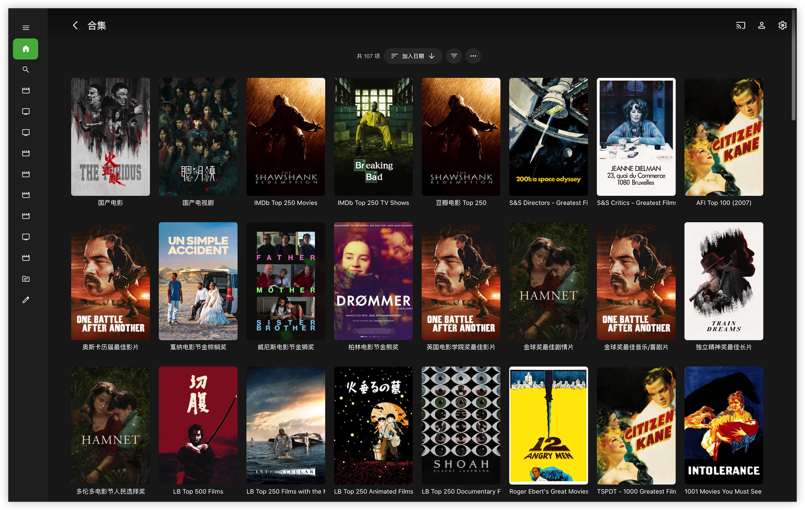

# Emby Collection Sync

[简体中文](README.md) | [繁體中文](README.zh-TW.md) | **English**

---

🚀 **A fully automated collection management and media acquisition pipeline for Emby.**

Seamlessly synchronize authoritative lists like IMDb/Douban Top 250/Letterboxd/TSPDT, **9 Global Prestigious Film Awards**, and Douban's 28 movie genre categories with multi-dimensional lists (Trending, Top 20, Classics, Niche Masterpieces), plus Douban TV region and type lists. It intelligently scans your local library for missing media, and **supports custom exclusion lists to seamlessly integrate with MoviePilot for automated downloading**. The system auto-aggregates Chinese-language media and **natively injects original-language posters using smart fetching strategies and an async queue engine to permanently resolve Emby's performance bottlenecks (UI freezes) caused by default collage generation.** Realize a complete closed-loop from automated library management to immersive viewing.

## 🔗 Publicly Maintained TMDb Lists

The following TMDb lists are fully maintained by automated crawlers and ETL pipelines. **Data fetching, comparison, and synchronization run daily at 07:30 (UTC+8)** to ensure rankings remain perfectly aligned with official sources.

### 🏆 Tiers 1 & 2: Mainstream Essentials & Cinematic Hall of Fame

* 🍿 **IMDb Top 250 Movies**: [View Grid](https://www.themoviedb.org/list/8647021?view=grid)
* 📺 **IMDb Top 250 TV Shows**: [View Grid](https://www.themoviedb.org/list/8647022?view=grid)
* 🎞️ **Douban Movies Top 250**: [View Grid](https://www.themoviedb.org/list/8647023?view=grid)
* 🏛️ **S&S Directors - Greatest Films**: [View Grid](https://www.themoviedb.org/list/8649058?view=grid)
* 🏛️ **S&S Critics - Greatest Films**: [View Grid](https://www.themoviedb.org/list/8649050?view=grid)
* ⭐ **AFI Top 100 (2007)**: [View Grid](https://www.themoviedb.org/list/8649041?view=grid)
* 📰 **NYT - 100 Best Movies of the 21st Century (2025)**: [View Grid](https://www.themoviedb.org/list/8701141?view=grid)
* 📡 **NYT - 100 Best TV Shows of the 21st Century (2026)**: [View Grid](https://www.themoviedb.org/list/8701142?view=grid)

### 🌍 Tier 3: Global Prestigious Film Awards

* 🏆 **Oscar Winning Films: Best Picture**: [View Grid](https://www.themoviedb.org/list/8648843?view=grid)
* 🌿 **Cannes Film Festival Palme d'Or**: [View Grid](https://www.themoviedb.org/list/8648844?view=grid)
* 🎭 **BAFTA Award for Best Film**: [View Grid](https://www.themoviedb.org/list/8648848?view=grid)
* 🌐 **Golden Globe Best Drama**: [View Grid](https://www.themoviedb.org/list/8648849?view=grid)
* 🥂 **Golden Globe Best Musical/Comedy**: [View Grid](https://www.themoviedb.org/list/8648850?view=grid)
* 🕊️ **Indie Spirit Award for Best Feature**: [View Grid](https://www.themoviedb.org/list/8648851?view=grid)
* 🐻 **Berlinale Film Festival Golden Bear**: [View Grid](https://www.themoviedb.org/list/8648852?view=grid)
* 🦁 **Venice Film Festival Golden Lion**: [View Grid](https://www.themoviedb.org/list/8648854?view=grid)
* 🍁 **Toronto Film Festival Audience Award**: [View Grid](https://www.themoviedb.org/list/8648855?view=grid)

### 🎬 Tier 4: Cinephile Communities & Curations

* 🎬 **LB Top 500 Films**: [View Grid](https://www.themoviedb.org/list/8648802?view=grid)
* 🔥 **LB Top 250 Films with the Most Fans**: [View Grid](https://www.themoviedb.org/list/8649224?view=grid)
* 🎨 **LB Top 250 Animated Films**: [View Grid](https://www.themoviedb.org/list/8649225?view=grid)
* 📽️ **LB Top 250 Documentary Films**: [View Grid](https://www.themoviedb.org/list/8649231?view=grid)
* 📝 **Roger Ebert's Great Movies**: [View Grid](https://www.themoviedb.org/list/8649219?view=grid)

### 📚 Tier 5: Ultimate Collection Targets (1000+ Films)

* 🎥 **TSPDT - 1000 Greatest Films**: [View Grid](https://www.themoviedb.org/list/8648821?view=grid)
* 📖 **1001 Movies You Must See Before You Die**: [View Grid](https://www.themoviedb.org/list/8649029?view=grid)
* 💽 **Criterion Collection**: [View Grid](https://www.themoviedb.org/list/8649108?view=grid)

### ✨ Tier 6: Modern Indie Labels & Studios

* ✨ **Every A24 Film**: [View Grid](https://www.themoviedb.org/list/8649217?view=grid)
* 🔴 **Every NEON Film**: [View Grid](https://www.themoviedb.org/list/8649218?view=grid)
* 🎞️ **Every MUBI Film**: [View Grid](https://www.themoviedb.org/list/8649220?view=grid)

### 📈 Tier 7: Trending & Popular

* 📈 **Douban - Weekly Highly Rated Movies**: [View Grid](https://www.themoviedb.org/list/8648547?view=grid)
* 📺 **Douban - Highly Rated Chinese Series**: [View Grid](https://www.themoviedb.org/list/8648548?view=grid)
* 🌍 **Douban - Highly Rated Global Series**: [View Grid](https://www.themoviedb.org/list/8648549?view=grid)
* 🔥 **Douban - Real-time Hot Movies**: [View Grid](https://www.themoviedb.org/list/8648550?view=grid)
* 🔥 **Douban - Real-time Hot TV Shows**: [View Grid](https://www.themoviedb.org/list/8648551?view=grid)
* 📈 **TMDB - Popular Movies**: [View Grid](https://www.themoviedb.org/list/8706223?view=grid)
* 📺 **TMDB - Popular TV Shows**: [View Grid](https://www.themoviedb.org/list/8706224?view=grid)
* 🔥 **TMDB - Trending Movies This Week**: [View Grid](https://www.themoviedb.org/list/8706225?view=grid)
* 🔥 **TMDB - Trending TV Shows This Week**: [View Grid](https://www.themoviedb.org/list/8706226?view=grid)

### 📂 Douban 28 Movie Genre Lists

* 🎭 **Drama**: [Top 20](https://www.themoviedb.org/list/8647681?view=grid) | [Classics](https://www.themoviedb.org/list/8648565?view=grid)
* 😂 **Comedy**: [Trending](https://www.themoviedb.org/list/8648552?view=grid) | [Top 20](https://www.themoviedb.org/list/8647682?view=grid) | [Classics](https://www.themoviedb.org/list/8648566?view=grid) | [Niche](https://www.themoviedb.org/list/8648595?view=grid)
* 💥 **Action**: [Trending](https://www.themoviedb.org/list/8648555?view=grid) | [Top 20](https://www.themoviedb.org/list/8647683?view=grid) | [Classics](https://www.themoviedb.org/list/8648568?view=grid) | [Niche](https://www.themoviedb.org/list/8648597?view=grid)
* ❤️ **Romance**: [Trending](https://www.themoviedb.org/list/8648553?view=grid) | [Top 20](https://www.themoviedb.org/list/8647684?view=grid) | [Classics](https://www.themoviedb.org/list/8648567?view=grid) | [Niche](https://www.themoviedb.org/list/8648596?view=grid)
* 🚀 **Sci-Fi**: [Trending](https://www.themoviedb.org/list/8648556?view=grid) | [Top 20](https://www.themoviedb.org/list/8647685?view=grid) | [Classics](https://www.themoviedb.org/list/8648570?view=grid) | [Niche](https://www.themoviedb.org/list/8648598?view=grid)
* 🎨 **Animation**: [Trending](https://www.themoviedb.org/list/8648557?view=grid) | [Top 20](https://www.themoviedb.org/list/8647686?view=grid) | [Classics](https://www.themoviedb.org/list/8648571?view=grid) | [Niche](https://www.themoviedb.org/list/8648599?view=grid)
* 🔍 **Mystery**: [Trending](https://www.themoviedb.org/list/8648558?view=grid) | [Top 20](https://www.themoviedb.org/list/8647687?view=grid) | [Classics](https://www.themoviedb.org/list/8648572?view=grid) | [Niche](https://www.themoviedb.org/list/8648600?view=grid)
* 😱 **Thriller**: [Trending](https://www.themoviedb.org/list/8648560?view=grid) | [Top 20](https://www.themoviedb.org/list/8647688?view=grid) | [Classics](https://www.themoviedb.org/list/8648574?view=grid) | [Niche](https://www.themoviedb.org/list/8648602?view=grid)
* 👻 **Horror**: [Trending](https://www.themoviedb.org/list/8648562?view=grid) | [Top 20](https://www.themoviedb.org/list/8647689?view=grid) | [Classics](https://www.themoviedb.org/list/8648581?view=grid) | [Niche](https://www.themoviedb.org/list/8648607?view=grid)
* 📽️ **Documentary**: [Top 20](https://www.themoviedb.org/list/8647690?view=grid)
* ⏱️ **Short Film**: [Top 20](https://www.themoviedb.org/list/8647691?view=grid)
* 🔞 **Erotica**: [Top 20](https://www.themoviedb.org/list/8647692?view=grid) | [Classics](https://www.themoviedb.org/list/8648586?view=grid) | [Niche](https://www.themoviedb.org/list/8648612?view=grid)
* 🎵 **Music**: [Top 20](https://www.themoviedb.org/list/8647693?view=grid) | [Classics](https://www.themoviedb.org/list/8648578?view=grid) | [Niche](https://www.themoviedb.org/list/8648604?view=grid)
* 💃 **Musical**: [Top 20](https://www.themoviedb.org/list/8647694?view=grid) | [Classics](https://www.themoviedb.org/list/8648584?view=grid) | [Niche](https://www.themoviedb.org/list/8648610?view=grid)
* 🏠 **Family**: [Top 20](https://www.themoviedb.org/list/8647695?view=grid) | [Classics](https://www.themoviedb.org/list/8648576?view=grid)
* 👶 **Children**: [Top 20](https://www.themoviedb.org/list/8647696?view=grid) | [Classics](https://www.themoviedb.org/list/8648577?view=grid)
* 📖 **Biography**: [Trending](https://www.themoviedb.org/list/8648564?view=grid) | [Top 20](https://www.themoviedb.org/list/8647697?view=grid) | [Classics](https://www.themoviedb.org/list/8648583?view=grid) | [Niche](https://www.themoviedb.org/list/8648609?view=grid)
* 📜 **History**: [Top 20](https://www.themoviedb.org/list/8647698?view=grid) | [Classics](https://www.themoviedb.org/list/8648579?view=grid) | [Niche](https://www.themoviedb.org/list/8648605?view=grid)
* ⚔️ **War**: [Trending](https://www.themoviedb.org/list/8648563?view=grid) | [Top 20](https://www.themoviedb.org/list/8647699?view=grid) | [Classics](https://www.themoviedb.org/list/8648582?view=grid) | [Niche](https://www.themoviedb.org/list/8648608?view=grid)
* 🚔 **Crime**: [Trending](https://www.themoviedb.org/list/8648559?view=grid) | [Top 20](https://www.themoviedb.org/list/8647700?view=grid) | [Classics](https://www.themoviedb.org/list/8648573?view=grid) | [Niche](https://www.themoviedb.org/list/8648601?view=grid)
* 🤠 **Western**: [Top 20](https://www.themoviedb.org/list/8647702?view=grid) | [Classics](https://www.themoviedb.org/list/8648588?view=grid)
* 🧙 **Fantasy**: [Top 20](https://www.themoviedb.org/list/8647703?view=grid) | [Classics](https://www.themoviedb.org/list/8648580?view=grid) | [Niche](https://www.themoviedb.org/list/8648606?view=grid)
* 🗺️ **Adventure**: [Trending](https://www.themoviedb.org/list/8648561?view=grid) | [Top 20](https://www.themoviedb.org/list/8647704?view=grid) | [Classics](https://www.themoviedb.org/list/8648575?view=grid) | [Niche](https://www.themoviedb.org/list/8648603?view=grid)
* 🌋 **Disaster**: [Top 20](https://www.themoviedb.org/list/8647705?view=grid) | [Classics](https://www.themoviedb.org/list/8648587?view=grid) | [Niche](https://www.themoviedb.org/list/8648613?view=grid)
* 🗡️ **Wuxia**: [Top 20](https://www.themoviedb.org/list/8647706?view=grid) | [Classics](https://www.themoviedb.org/list/8648585?view=grid) | [Niche](https://www.themoviedb.org/list/8648611?view=grid)
* 🏮 **Period & Costume**: [Top 20](https://www.themoviedb.org/list/8647707?view=grid) | [Classics](https://www.themoviedb.org/list/8648593?view=grid)
* 🏃 **Sports**: [Top 20](https://www.themoviedb.org/list/8647708?view=grid) | [Classics](https://www.themoviedb.org/list/8648594?view=grid)
* 🌑 **Film Noir**: [Top 20](https://www.themoviedb.org/list/8647709?view=grid)

### 📺 Douban TV Region & Type Lists

* 🇨🇳 **Mainland China**: [Trending](https://www.themoviedb.org/list/8702683?view=grid) | [Classics](https://www.themoviedb.org/list/8702684?view=grid) | [Niche](https://www.themoviedb.org/list/8702685?view=grid)
* 🇺🇸 **US**: [Trending](https://www.themoviedb.org/list/8702686?view=grid) | [Classics](https://www.themoviedb.org/list/8702687?view=grid) | [Niche](https://www.themoviedb.org/list/8702688?view=grid)
* 🇬🇧 **UK**: [Classics](https://www.themoviedb.org/list/8702689?view=grid) | [Niche](https://www.themoviedb.org/list/8702690?view=grid)
* 🇯🇵 **Japan**: [Trending](https://www.themoviedb.org/list/8702691?view=grid) | [Classics](https://www.themoviedb.org/list/8702692?view=grid) | [Niche](https://www.themoviedb.org/list/8702693?view=grid)
* 🇰🇷 **South Korea**: [Trending](https://www.themoviedb.org/list/8702694?view=grid) | [Classics](https://www.themoviedb.org/list/8702695?view=grid) | [Niche](https://www.themoviedb.org/list/8702696?view=grid)
* 🇭🇰 **Hong Kong**: [Classics](https://www.themoviedb.org/list/8702697?view=grid) | [Niche](https://www.themoviedb.org/list/8702698?view=grid)
* 🇨🇳 **Taiwan, China**: [Classics](https://www.themoviedb.org/list/8702699?view=grid) | [Niche](https://www.themoviedb.org/list/8702700?view=grid)
* 🇹🇭 **Thailand**: [Niche](https://www.themoviedb.org/list/8702701?view=grid)
* 🇪🇺 **Europe**: [Trending](https://www.themoviedb.org/list/8702702?view=grid) | [Classics](https://www.themoviedb.org/list/8702703?view=grid)
* 🎨 **Animation**: [Classics](https://www.themoviedb.org/list/8702704?view=grid)

## ✨ Core Features

* **🏆 Automated Top List Maintenance**
  * Supports IMDb/Douban Top 250/Letterboxd/TSPDT Lists, **9 Global Prestigious Film Awards**, and **Douban's 28 movie genre categories with multi-dimensional lists (Trending, Top 20, Classics, Niche Masterpieces), plus Douban TV region and type lists**.
  * **Metadata Sync**: Fetches TMDb list descriptions and writes them to the Emby Collection `Overview`.
  * **Global Favorites**: Automatically adds generated collections to "My Favorites" for all Emby users, boosting visibility.
* **🖼️ Poster Injection & Async Performance Engine**
  * **Eliminate UI Freezes**: Prevents Emby server crashes or scraping bottlenecks caused by generating default 4-grid collage thumbnails.
  * **Async Queue Injection**: Introduces a global task queue with dynamic delayed batch processing. Decouples collection creation from poster injection to significantly reduce execution time and prevent SQLite database locks/overwrites.
  * **Smart Fetching Strategies**: Highly customizable poster extraction logic (absolute list top vs. highest-ranked in local library; newest premiere vs. latest added) for a personalized poster wall.
  * **Collection Cover Repair**: Repairs coverless collections using a poster from the earliest released media item in the collection.
  * **Movie & TV Cover Repair**: Adds TMDb original-language posters to movies and TV shows missing a primary image. Existing covers are skipped. Missing TMDb IDs or unavailable original-language posters are reported without substituting another language.
* **🍿 MoviePilot Integration**
  * **Smart Subscription Policies**: Automatically triggers MoviePilot API to subscribe to missing media. **Supports flexible policies: toggle per list (True/False) or set a rank threshold (Integer, e.g., 3, to only subscribe to the top 3 missing items), providing precise control over resource acquisition.**
  * **Custom Exclusion Lists**: Configure separate movie and series exclusion lists (`MP_EXCLUDE_MOVIE_IDS` / `MP_EXCLUDE_SERIES_IDS`) to skip specific media from auto-downloading, with intercepted counts displayed in the final report.
  * **Anti-Duplication**: Cross-checks existing MP subscriptions before pushing requests to avoid duplicate entries.
* **📁 Gap Analysis & Reporting**
  * Precise push notifications detailing missing items, their rankings, `{tmdb-id}`, and dynamic stats for successful, existing, and excluded MP subscriptions.
  * **Cover Repair Report**: Reports collection, movie and TV repair counts separately, with a combined list of successful repairs and reasons for failures.
  * **Adaptive Formatting**: Uses a concise overview mode for genre lists to prevent notifications from being truncated by messaging apps.
* **🇨🇳 Regional Media Aggregation**
  * Automatically groups Chinese-language media based on directory keywords and TMDb origin country codes (`CN/HK/TW`).
* **🛡️ Robust Error Handling**
  * Optimized API request paths for various Emby versions to bypass JSON parsing exceptions, ensuring stable execution in complex network environments.

## 📸 Showcase

*(Auto-generated customized poster walls and collection categories in Emby)*

## 🚀 Quick Start (via Qinglong Panel)

1. **Deploy Script**: Place `emby_collection_sync.py` into the `scripts` directory of your Qinglong Panel.
2. **Install Dependencies**: Install the `requests` and `urllib3` Python packages.
3. **Configuration**: Open the script and configure your **Emby**, **TMDb**, and **MoviePilot** URLs and API Keys.
4. **Subscription Policy**: Adjust `mp_subscribe` in the `CUSTOM_LISTS` config:
   - `True`: Subscribe to all missing items.
   - `False`: Report only.
   - `Integer (e.g., 3)`: Only subscribe to missing items ranked within the top 3.
5. **Cron Job**: Create a new scheduled task with the command `task emby_collection_sync.py` (Recommended cron expression: `0 30 8 * * *` for daily execution at 08:30).

## 📈 Star History

<a href="https://www.star-history.com/?repos=ffinly%2Femby-collection-sync&amp;type=date&amp;legend=top-left">
  <picture>
    <source media="(prefers-color-scheme: dark)" srcset="https://api.star-history.com/chart?repos=ffinly/emby-collection-sync&amp;type=date&amp;theme=dark&amp;legend=top-left" />
    <source media="(prefers-color-scheme: light)" srcset="https://api.star-history.com/chart?repos=ffinly/emby-collection-sync&amp;type=date&amp;legend=top-left" />
    
  </picture>
</a>

## 📄 License

This project is licensed under the [GPL-3.0 license](LICENSE) - see the LICENSE file for details.
