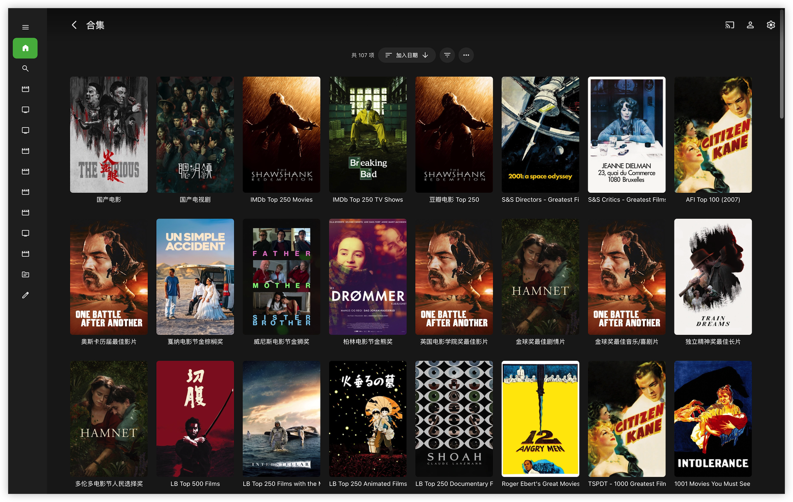

# Emby Collection Sync

**简体中文** | [繁體中文](README.zh-TW.md) | [English](README.en.md)

将 TMDb 榜单同步为 Emby 合集，支持缺失报告、MoviePilot 自动订阅、国家/地区影视整理和原语言海报。适用于青龙面板，也可以直接使用 Python 运行。

## 🎬 与 Emby Companion 配合

[Emby Companion](https://github.com/ffinly/emby-companion) 是一款 macOS 观影助手，支持榜单选片、入库与缺集核对、手动订阅，并可调用本地播放器观看。应用使用本项目的预置榜单，本脚本负责定时整理 Emby 服务端合集；两者可独立使用，也可搭配使用。

## ✨ 核心特性

- **🏆 榜单自动同步**：内置 157 个 IMDb、豆瓣、Letterboxd、TMDb 等榜单，支持添加自己的 TMDb 列表、同步简介并报告缺失影片。
- **📌 每日重建置顶**：保留创建顺序，在 Emby 按添加日期降序排列时，让本次生成的合集排在其他旧合集前面；完成并校验新合集后再删除旧合集。
- **🌏 国家／地区合集**：默认 `CN` 合并中国大陆、香港、台湾、澳门；可增加其他代码，不写 `CN` 则不生成国产合集，留空则关闭国家合集。
- **🌐 单文件与三语支持**：只需部署 `emby_collection_sync.py`；常用参数在最前面，内置简体中文、繁体中文和英文日志、通知及榜单名称。
- **⭐ 收藏例外用户名**：默认自动收藏，可按 Emby 用户名设置例外，也可以关闭自动收藏。
- **🍿 MoviePilot 自动订阅**：支持全量、前 N 名、仅报告三种榜单策略；电影与剧集分别排除，电视剧按季检查订阅。
- **🖼️ 海报与运行报告**：原语言海报、缺主封面修复、缺失详情、订阅与修复统计；提供缓存、分页校验、连接配置检查和日志密钥脱敏。

## 📸 运行效果展示



*Emby 合集海报墙与分类展示。*

## 🚀 快速开始 (以青龙面板为例)

需要 **Python 3.9+**、可访问的 Emby 服务器和 TMDb API Key。MoviePilot 为可选功能。

1. 把 [emby_collection_sync.py](emby_collection_sync.py) 放入青龙 `scripts` 目录；无需额外的 Python 配置文件。
2. 在青龙「依赖管理 → Python3」安装 `requests`、`urllib3`。
3. 在青龙「环境变量」添加 `EMBY_URL`、`EMBY_API_KEY`、`TMDB_API_KEY`；填写方式与可选变量见[连接配置](#连接配置默认读取环境变量)。
4. 修改脚本顶部的语言、国家码、收藏例外等参数，以及下方榜单的订阅策略；同步逻辑无需修改。
5. 执行 `task emby_collection_sync.py`，直接同步合集并按配置处理收藏、订阅与通知。
6. 每天执行一次即可。标准五段 cron 示例：`30 8 * * *`（每天 08:30）；如果你的面板使用含秒的六段格式，则为 `0 30 8 * * *`。时间以面板配置的时区为准。

青龙通知沿用 `notify.send`，在面板通知设置中配置渠道即可；没有 `notify` 模块时只在控制台输出，不要求安装同名第三方包。

### 脚本结构与多语言配置

| 脚本区域 | 内容 |
| --- | --- |
| 顶部常用参数 | 语言、国家码、收藏例外、连接信息、代理和海报策略 |
| 榜单配置 | 核心榜单、豆瓣分类、历史名称映射与图标 |
| 多语言数据 | 榜单译名、日志与通知文案、国家／地区名称 |
| 同步逻辑 | API 请求、每日重建、订阅、收藏与通知 |

脚本前面放常用参数，后面依次放榜单、翻译和同步逻辑。`LIST_NAMES` 按榜单 ID 配置 `zh-CN`、`zh-TW`、`en` 名称；`MESSAGES` 以英文为键，按 `zh-CN`、`zh-TW`、`en` 保存日志和通知文案；`COUNTRY_LABELS` 配置国家／地区的三语名称，`COUNTRY_ALIASES` 补充别名，`COUNTRY_LEGACY_LABELS` 保留旧译名用于合集更名匹配。修改文案时保留 `{name}` 等占位符。只需要切换语言时，改 `LANGUAGE` 即可。

脚本顶部说明和配置注释提供三语；同步逻辑使用英文代码和注释，实际显示文案从内置三语表读取。

只需为 `emby_collection_sync.py` 建立定时任务。更新脚本前，请备份并合并自己的参数和榜单策略。

### 脚本顶部的常用参数

配置注释同时提供简体中文、繁体中文和英文；日志与通知只显示 `LANGUAGE` 选中的语言。

```python
LANGUAGE = "zh-CN"                    # zh-CN / zh-TW / en
COUNTRY_CODES = ["CN"]                 # CN 合并大陆、香港、台湾、澳门；[] 关闭国家合集
FAVORITES_ENABLE = True                # 默认继续全员自动收藏
FAVORITES_EXCLUDE_USERS = ["kids"]      # 例外：Emby 用户名，精确匹配、区分大小写
MP_ENABLE = False                     # 开启后需配置 MP_URL 和 MP_API_TOKEN
USE_PROXY = False                     # 开启后还需填写 PROXY_URL
EMBY_VERIFY_SSL = True                 # 验证 Emby HTTPS 证书；自签证书可设 False
MP_VERIFY_SSL = True                   # 验证 MoviePilot HTTPS 证书；自签证书可设 False
LIST_POSTER_MODE = "library"           # library：库内榜单第一；list：榜单第一
DOMESTIC_POSTER_MODE = "premiere"      # premiere：最新上映；added：最新入库
POSTER_SIZE = "w780"                   # w780 / original
COUNTRY_CACHE_DAYS = 90                # 产地缓存有效天数，必须大于 0
```

上面的 `kids` 是示例，脚本默认例外名单为空。填写 **Emby 的实际用户名**，不是用户 ID；例外用户不会被脚本自动添加收藏，也不会主动清除其已有收藏。每日重建会产生新合集 ID，旧合集上的个人收藏状态不会被迁移。这个设置不是内容访问控制：儿童账户能否看到某个合集，仍需在 Emby 中设置权限。

`LANGUAGE` 同时影响脚本日志、通知、内置榜单名称和国家合集名称。脚本向 TMDb 请求对应语言的标题；实际返回内容取决于 TMDb 是否提供翻译。自定义榜单名称保持原样，第三方 API 返回的错误说明也保留原文。

### 连接配置（默认读取环境变量）

默认读取环境变量；也可以按脚本配置区的注释示例，替换对应赋值行。手动赋值后该项以填写的值为准，其他未修改的项目仍读环境变量。例如脚本中保留的是：

```python
MP_URL = os.getenv("MP_URL")
# MP_URL = "http://192.168.1.10:3000"
MP_API_TOKEN = os.getenv("MP_API_TOKEN")
# MP_API_TOKEN = "your-mp-api-token"
```

以上手动值只是注释，不会默认启用。Emby、TMDb、MoviePilot、代理和 TMDb v4 token 都提供相同写法。`EMBY_SYNC_CACHE` 用环境变量指定国家缓存路径。

| 变量 | 必填条件 | 说明 |
| --- | --- | --- |
| `EMBY_URL` | 必填 | Emby 根地址，如 `http://192.168.1.100:8096`，不要再加 `/emby` |
| `EMBY_API_KEY` | 必填 | Emby API Key |
| `TMDB_API_KEY` | 必填 | TMDb v3 API Key |
| `MP_URL` | `MP_ENABLE = True` | MoviePilot 服务地址 |
| `MP_API_TOKEN` | `MP_ENABLE = True` | MoviePilot API Token |
| `PROXY_URL` | `USE_PROXY = True` | TMDb API 和图片请求使用的 HTTP(S) 代理地址 |
| `TMDB_ACCESS_TOKEN` | 可选 | TMDb API Read Access Token；v3 列表返回 404 时，用它尝试 v4。私有列表需要有权限的用户 token |
| `EMBY_SYNC_CACHE` | 可选 | 国家查询缓存文件的完整路径，默认放在脚本旁的 `.emby_country_cache.json` |

缺少必填连接配置或参数错误时，脚本会在连接服务器之前直接指出问题。HTTPS 默认验证证书；关闭 Emby 或 MoviePilot 的验证不会影响 TMDb API 和图片站的验证。

### 按国家/地区生成合集

- 默认 `COUNTRY_CODES = ["CN"]`：生成「国产电影」「国产电视剧」。**本脚本的 `CN` 是合并分组，包含中国大陆、香港、台湾、澳门，对应 TMDb 代码 `CN/HK/TW/MO`**，不是仅匹配 TMDb 的单个 `CN` 代码。
- 不写 `CN` 就不生成国产合集。例如 `["JP", "US"]` 只生成日本、美国的电影与剧集合集；`[]` 不生成任何国家／地区合集，其他榜单同步照常运行。无需另设开关。
- `HK`、`TW`、`MO` 也可以单独填写，生成各自的地区合集；与 `CN` 同时填写时，相关资源可以同时进入合并合集和独立地区合集。
- 所有国家／地区合集统一使用 TMDb 国家码分类：电影读取 `production_countries`，剧集读取 `origin_country`，`CN` 电影也遵循此规则。联合制作可以进入多个合集；这是产地分类，不是对白语言分类。
- 离线内置 272 个国家／地区的完整三语名称，包含 `SU`（苏联）、`XC`（捷克斯洛伐克）等历史地区。`NZ` 会显示为「新西兰／紐西蘭／New Zealand」，国家名称查询无需额外网络请求。
- 配置支持两位代码和已知别名／名称：`UK` 自动转为 `GB`，`USA` 转为 `US`，`USSR` 转为 `SU`；忽略首尾空格和大小写，归一后自动去重。仍建议填写代码；填写中国相关名称并归一为 `CN` 时，仍执行前述四地区合并规则。无法识别的配置会在连接服务器前报错，不进行模糊猜测。
- 更新名称时会识别旧译名及旧的代码式合集名称，例如将 `NZ电影` 对应到 `新西兰电影`，避免正常重建后留下重复合集。
- TMDb 查询结果默认缓存 90 天，可通过 `COUNTRY_CACHE_DAYS` 调整；有效期内直接使用缓存，到期后重新查询。查询返回 404（条目不存在）时，仅跳过该条目的国家分类并清除其旧产地缓存，继续处理其他条目，不改动 Emby 媒体库中的影片或剧集；下次运行会重新尝试查询。超时、限流或其他查询故障会优先使用历史缓存；没有可用缓存时保留该媒体类型的旧国家合集。缺少 TMDb ID 的条目会记录并跳过国家分类。

从配置中删除 `CN`、其他国家码或榜单，只停止后续生成和重建，不会自动删除已经存在的合集。

### 榜单与 MoviePilot 策略

`emby_collection_sync.py` 中保留 `CUSTOM_LISTS`、`DOUBAN_GENRE_LISTS`、`DOUBAN_TV_LISTS` 三组配置。可以删除不需要的条目，也可以添加自己的 TMDb 列表，不限于下方公开榜单。将条目添加到相应数组中；`id` 填写 TMDb 列表网址 `/list/` 后的数字，不要填写完整网址。以下 `123456` 仅为格式示例，请替换为自己的列表 ID：

```python
{"name": "我的片单", "id": "123456", "type": "Movie",
 "mp_subscribe": 3, "notify_missing": True}
```

`type` 为 `Movie` 或 `Series`；不写时按电影处理。`mp_subscribe` 可为 `True`（缺失即订阅）、`False`（仅报告）、正整数（只订阅榜单前 N 名中的缺失项，填 `0` 等同 `False`）。只有 `MP_ENABLE = True` 时才真正提交订阅。`notify_missing` 控制核心榜单的缺失详情；分类榜单沿用精简统计。

电影、剧集排除列表分别配置在 `MP_EXCLUDE_MOVIE_IDS`、`MP_EXCLUDE_SERIES_IDS`，数字和字符串 ID 均可。电视剧继续按季检查和订阅，季 0 表示特别篇。防重查询失败时停止对应订阅流程，避免把错误响应当成“尚未订阅”。

## 📌 每日重建与排序

按「豆瓣分类 → 核心榜单 → 国家合集」顺序执行。豆瓣分类与核心榜单分别倒序创建；国家合集先处理剧集、再处理电影，每种媒体类型内按国家码配置倒序创建，让靠前的配置项较晚创建。因此在 Emby 选择 **添加日期降序**，本次新建的这一组合集会排在其他旧合集前面。之后若有其他新合集创建，下次运行会再次置顶。

重建时先创建临时合集，分批添加并校验全部条目、写入正式名称，再删除旧合集。创建、添加或校验失败时保留旧合集。每次成功重建都会产生新的合集 ID，并按配置重新生成海报。

**同步目标按配置名称及历史名称匹配**。请把配置中的名称留给脚本使用：手工创建的同名合集也会被视为同步目标。切换语言时会识别内置榜单的旧语言名称，避免正常切换后留下重复合集。不同时运行两个同步任务；若任务被强制中断，可能留下名称含 `[sync-...]` 的临时合集，可确认后手工删除。

榜单拉取失败或分页不完整时不会重建该合集，也不会按残缺榜单提交订阅；空榜单或匹配不足两部时保留原合集。国家合集至少匹配一部才重建。匹配数量只决定是否重建合集，不影响完整榜单中缺失条目的订阅策略。其他不同名合集不会参与重建，但「缺封面修复」步骤仍会检查它们。

## 🖼️ 海报与报告

榜单合集海报按榜单第一或库内第一选择；国家合集按最新上映或入库排序，使用首个能获取到海报的条目。合集优先使用原语言海报，没有时可使用 TMDb 的其他可用海报。缺主封面的电影和剧集仅使用原语言海报，不覆盖已有主封面。海报任务在主流程之后**顺序执行**，不是异步并发。

默认下载 `w780` 海报以减少流量，可改回 `original`。上传新图前保留旧图。通知包含核心榜单明细、分类概览、缺失前 3 条、订阅和封面修复统计，并显示失败/跳过的合集。分类概览统计匹配达标的合集数量，不代表成功重建数量；重建失败会另行列出。

## 🐍 不使用青龙时运行

将 [emby_collection_sync.py](emby_collection_sync.py) 和 [requirements.txt](requirements.txt) 下载到同一目录，在终端进入该目录后执行以下命令（Linux/macOS）：

```bash
python3 -m venv .venv
source .venv/bin/activate
python3 -m pip install -r requirements.txt
export EMBY_URL="http://192.168.1.100:8096"
export EMBY_API_KEY="你的Emby密钥"
export TMDB_API_KEY="你的TMDb密钥"
python3 emby_collection_sync.py
```

定时运行时，在自己的任务环境中提供这些变量，并使用虚拟环境的 Python 完整路径。日志会对密钥和 URL 中的认证信息脱敏；手动填写的实际密钥请保留在自己的脚本副本中。

## 🔗 线上公开最新榜单列表

以下 TMDB 列表完全由自动化爬虫与 ETL 流水线自动维护。**系统会在每天早上 7:30 (UTC+8) 定时执行数据抓取、比对与同步更新**，确保榜单排名与官方时刻保持一致。

### 🏆 第一梯队：大众必看

* 🍿 **IMDb Top 250 Movies**: [查看网格墙视图](https://www.themoviedb.org/list/8647021?view=grid)
* 📺 **IMDb Top 250 TV Shows**: [查看网格墙视图](https://www.themoviedb.org/list/8647022?view=grid)
* 🎞️ **豆瓣电影 Top 250**: [查看网格墙视图](https://www.themoviedb.org/list/8647023?view=grid)

### 🏛️ 第二梯队：影史殿堂

* 🏛️ **S&S Directors - Greatest Films**: [查看网格墙视图](https://www.themoviedb.org/list/8649058?view=grid)
* 🏛️ **S&S Critics - Greatest Films**: [查看网格墙视图](https://www.themoviedb.org/list/8649050?view=grid)
* ⭐ **AFI Top 100 (2007)**: [查看网格墙视图](https://www.themoviedb.org/list/8649041?view=grid)
* 🎓 **Harvard Film PhD Program**: [查看网格墙视图](https://www.themoviedb.org/list/8714340?view=grid)
* 📰 **NYT - 100 Best Movies of the 21st Century (2025)**: [查看网格墙视图](https://www.themoviedb.org/list/8701141?view=grid)
* 📡 **NYT - 100 Best TV Shows of the 21st Century (2026)**: [查看网格墙视图](https://www.themoviedb.org/list/8701142?view=grid)

### 🌍 第三梯队：全球最具含金量大奖矩阵

* 🏆 **奥斯卡历届最佳影片**: [查看网格墙视图](https://www.themoviedb.org/list/8648843?view=grid)
* 🌿 **戛纳电影节金棕榈奖**: [查看网格墙视图](https://www.themoviedb.org/list/8648844?view=grid)
* 🦁 **威尼斯电影节金狮奖**: [查看网格墙视图](https://www.themoviedb.org/list/8648854?view=grid)
* 🐻 **柏林电影节金熊奖**: [查看网格墙视图](https://www.themoviedb.org/list/8648852?view=grid)
* 🎭 **英国电影学院奖最佳影片**: [查看网格墙视图](https://www.themoviedb.org/list/8648848?view=grid)
* 🌐 **金球奖最佳剧情片**: [查看网格墙视图](https://www.themoviedb.org/list/8648849?view=grid)
* 🥂 **金球奖最佳音乐/喜剧片**: [查看网格墙视图](https://www.themoviedb.org/list/8648850?view=grid)
* 🍁 **多伦多电影节人民选择奖**: [查看网格墙视图](https://www.themoviedb.org/list/8648855?view=grid)
* 🕊️ **独立精神奖最佳长片**: [查看网格墙视图](https://www.themoviedb.org/list/8648851?view=grid)

### 🎬 第四梯队：高阶影迷社区与名家策展

* 🎬 **LB Top 500 Films**: [查看网格墙视图](https://www.themoviedb.org/list/8648802?view=grid)
* 🔥 **LB Top 250 Films with the Most Fans**: [查看网格墙视图](https://www.themoviedb.org/list/8649224?view=grid)
* 💥 **LB Top 250 Action Films**: [查看网格墙视图](https://www.themoviedb.org/list/8714314?view=grid)
* 🎨 **LB Top 250 Animated Films**: [查看网格墙视图](https://www.themoviedb.org/list/8649225?view=grid)
* 📖 **LB Top 250 Biographical Films**: [查看网格墙视图](https://www.themoviedb.org/list/8714315?view=grid)
* 🚔 **LB Top 250 Crime Films**: [查看网格墙视图](https://www.themoviedb.org/list/8714316?view=grid)
* 📽️ **LB Top 250 Documentary Films**: [查看网格墙视图](https://www.themoviedb.org/list/8649231?view=grid)
* 🌑 **LB Top 100 Film Noir Films**: [查看网格墙视图](https://www.themoviedb.org/list/8714317?view=grid)
* 👻 **LB Top 250 Horror Films**: [查看网格墙视图](https://www.themoviedb.org/list/8714318?view=grid)
* 🧙 **LB Top 100 Live-Action Fantasy Films**: [查看网格墙视图](https://www.themoviedb.org/list/8714319?view=grid)
* 💃 **LB Top 250 Musical Films**: [查看网格墙视图](https://www.themoviedb.org/list/8714320?view=grid)
* 🔍 **LB Top 250 Mystery Films**: [查看网格墙视图](https://www.themoviedb.org/list/8714322?view=grid)
* 💕 **LB Top 250 Romantic Comedy Films**: [查看网格墙视图](https://www.themoviedb.org/list/8714328?view=grid)
* 🚀 **LB Top 250 Science Fiction Films**: [查看网格墙视图](https://www.themoviedb.org/list/8714330?view=grid)
* 🏃 **LB Top 100 Sports Films**: [查看网格墙视图](https://www.themoviedb.org/list/8714333?view=grid)
* ⚔️ **LB Top 250 War Films**: [查看网格墙视图](https://www.themoviedb.org/list/8714334?view=grid)
* 🤠 **LB Top 100 Western Films**: [查看网格墙视图](https://www.themoviedb.org/list/8714335?view=grid)
* 📝 **Roger Ebert's Great Movies**: [查看网格墙视图](https://www.themoviedb.org/list/8649219?view=grid)

### 📚 第五梯队：超大体量洗版底仓

* 🎥 **TSPDT - 1000 Greatest Films**: [查看网格墙视图](https://www.themoviedb.org/list/8648821?view=grid)
* 📖 **1001 Movies You Must See Before You Die**: [查看网格墙视图](https://www.themoviedb.org/list/8649029?view=grid)
* 💽 **Criterion Collection**: [查看网格墙视图](https://www.themoviedb.org/list/8649108?view=grid)

### ✨ 第六梯队：现代独立与流行厂牌

* ✨ **Every A24 Film**: [查看网格墙视图](https://www.themoviedb.org/list/8649217?view=grid)
* 🔴 **Every NEON Film**: [查看网格墙视图](https://www.themoviedb.org/list/8649218?view=grid)
* 🎟️ **Every MUBI Film**: [查看网格墙视图](https://www.themoviedb.org/list/8649220?view=grid)

### 📈 第七梯队：实时口碑与趋势榜

* 📈 **豆瓣 - 一周口碑电影榜**: [查看网格墙视图](https://www.themoviedb.org/list/8648547?view=grid)
* 📺 **豆瓣 - 华语口碑剧集榜**: [查看网格墙视图](https://www.themoviedb.org/list/8648548?view=grid)
* 🌍 **豆瓣 - 全球口碑剧集榜**: [查看网格墙视图](https://www.themoviedb.org/list/8648549?view=grid)
* 🔥 **豆瓣 - 实时热门电影榜**: [查看网格墙视图](https://www.themoviedb.org/list/8648550?view=grid)
* 🔥 **豆瓣 - 实时热门电视榜**: [查看网格墙视图](https://www.themoviedb.org/list/8648551?view=grid)
* 📈 **TMDB - 热门电影榜**: [查看网格墙视图](https://www.themoviedb.org/list/8706223?view=grid)
* 📺 **TMDB - 热门剧集榜**: [查看网格墙视图](https://www.themoviedb.org/list/8706224?view=grid)
* 🔥 **TMDB - 本周趋势电影榜**: [查看网格墙视图](https://www.themoviedb.org/list/8706225?view=grid)
* 🔥 **TMDB - 本周趋势剧集榜**: [查看网格墙视图](https://www.themoviedb.org/list/8706226?view=grid)

### 📂 豆瓣电影 28 大分类多维度榜单

* 🎭 **剧情**: [Top 20](https://www.themoviedb.org/list/8647681?view=grid) | [高分经典](https://www.themoviedb.org/list/8648565?view=grid)
* 😂 **喜剧**: [近期热门](https://www.themoviedb.org/list/8648552?view=grid) | [Top 20](https://www.themoviedb.org/list/8647682?view=grid) | [高分经典](https://www.themoviedb.org/list/8648566?view=grid) | [冷门佳作](https://www.themoviedb.org/list/8648595?view=grid)
* 💥 **动作**: [近期热门](https://www.themoviedb.org/list/8648555?view=grid) | [Top 20](https://www.themoviedb.org/list/8647683?view=grid) | [高分经典](https://www.themoviedb.org/list/8648568?view=grid) | [冷门佳作](https://www.themoviedb.org/list/8648597?view=grid)
* ❤️ **爱情**: [近期热门](https://www.themoviedb.org/list/8648553?view=grid) | [Top 20](https://www.themoviedb.org/list/8647684?view=grid) | [高分经典](https://www.themoviedb.org/list/8648567?view=grid) | [冷门佳作](https://www.themoviedb.org/list/8648596?view=grid)
* 🚀 **科幻**: [近期热门](https://www.themoviedb.org/list/8648556?view=grid) | [Top 20](https://www.themoviedb.org/list/8647685?view=grid) | [高分经典](https://www.themoviedb.org/list/8648570?view=grid) | [冷门佳作](https://www.themoviedb.org/list/8648598?view=grid)
* 🎨 **动画**: [近期热门](https://www.themoviedb.org/list/8648557?view=grid) | [Top 20](https://www.themoviedb.org/list/8647686?view=grid) | [高分经典](https://www.themoviedb.org/list/8648571?view=grid) | [冷门佳作](https://www.themoviedb.org/list/8648599?view=grid)
* 🔍 **悬疑**: [近期热门](https://www.themoviedb.org/list/8648558?view=grid) | [Top 20](https://www.themoviedb.org/list/8647687?view=grid) | [高分经典](https://www.themoviedb.org/list/8648572?view=grid) | [冷门佳作](https://www.themoviedb.org/list/8648600?view=grid)
* 😱 **惊悚**: [近期热门](https://www.themoviedb.org/list/8648560?view=grid) | [Top 20](https://www.themoviedb.org/list/8647688?view=grid) | [高分经典](https://www.themoviedb.org/list/8648574?view=grid) | [冷门佳作](https://www.themoviedb.org/list/8648602?view=grid)
* 👻 **恐怖**: [近期热门](https://www.themoviedb.org/list/8648562?view=grid) | [Top 20](https://www.themoviedb.org/list/8647689?view=grid) | [高分经典](https://www.themoviedb.org/list/8648581?view=grid) | [冷门佳作](https://www.themoviedb.org/list/8648607?view=grid)
* 📽️ **纪录片**: [Top 20](https://www.themoviedb.org/list/8647690?view=grid)
* ⏱️ **短片**: [Top 20](https://www.themoviedb.org/list/8647691?view=grid)
* 🔞 **情色**: [Top 20](https://www.themoviedb.org/list/8647692?view=grid) | [高分经典](https://www.themoviedb.org/list/8648586?view=grid) | [冷门佳作](https://www.themoviedb.org/list/8648612?view=grid)
* 🎵 **音乐**: [Top 20](https://www.themoviedb.org/list/8647693?view=grid) | [高分经典](https://www.themoviedb.org/list/8648578?view=grid) | [冷门佳作](https://www.themoviedb.org/list/8648604?view=grid)
* 💃 **歌舞**: [Top 20](https://www.themoviedb.org/list/8647694?view=grid) | [高分经典](https://www.themoviedb.org/list/8648584?view=grid) | [冷门佳作](https://www.themoviedb.org/list/8648610?view=grid)
* 🏠 **家庭**: [Top 20](https://www.themoviedb.org/list/8647695?view=grid) | [高分经典](https://www.themoviedb.org/list/8648576?view=grid)
* 👶 **儿童**: [Top 20](https://www.themoviedb.org/list/8647696?view=grid) | [高分经典](https://www.themoviedb.org/list/8648577?view=grid)
* 📖 **传记**: [近期热门](https://www.themoviedb.org/list/8648564?view=grid) | [Top 20](https://www.themoviedb.org/list/8647697?view=grid) | [高分经典](https://www.themoviedb.org/list/8648583?view=grid) | [冷门佳作](https://www.themoviedb.org/list/8648609?view=grid)
* 📜 **历史**: [Top 20](https://www.themoviedb.org/list/8647698?view=grid) | [高分经典](https://www.themoviedb.org/list/8648579?view=grid) | [冷门佳作](https://www.themoviedb.org/list/8648605?view=grid)
* ⚔️ **战争**: [近期热门](https://www.themoviedb.org/list/8648563?view=grid) | [Top 20](https://www.themoviedb.org/list/8647699?view=grid) | [高分经典](https://www.themoviedb.org/list/8648582?view=grid) | [冷门佳作](https://www.themoviedb.org/list/8648608?view=grid)
* 🚔 **犯罪**: [近期热门](https://www.themoviedb.org/list/8648559?view=grid) | [Top 20](https://www.themoviedb.org/list/8647700?view=grid) | [高分经典](https://www.themoviedb.org/list/8648573?view=grid) | [冷门佳作](https://www.themoviedb.org/list/8648601?view=grid)
* 🤠 **西部**: [Top 20](https://www.themoviedb.org/list/8647702?view=grid) | [高分经典](https://www.themoviedb.org/list/8648588?view=grid)
* 🧙 **奇幻**: [Top 20](https://www.themoviedb.org/list/8647703?view=grid) | [高分经典](https://www.themoviedb.org/list/8648580?view=grid) | [冷门佳作](https://www.themoviedb.org/list/8648606?view=grid)
* 🗺️ **冒险**: [近期热门](https://www.themoviedb.org/list/8648561?view=grid) | [Top 20](https://www.themoviedb.org/list/8647704?view=grid) | [高分经典](https://www.themoviedb.org/list/8648575?view=grid) | [冷门佳作](https://www.themoviedb.org/list/8648603?view=grid)
* 🌋 **灾难**: [Top 20](https://www.themoviedb.org/list/8647705?view=grid) | [高分经典](https://www.themoviedb.org/list/8648587?view=grid) | [冷门佳作](https://www.themoviedb.org/list/8648613?view=grid)
* 🥋 **武侠**: [Top 20](https://www.themoviedb.org/list/8647706?view=grid) | [高分经典](https://www.themoviedb.org/list/8648585?view=grid) | [冷门佳作](https://www.themoviedb.org/list/8648611?view=grid)
* 🏮 **古装**: [Top 20](https://www.themoviedb.org/list/8647707?view=grid) | [高分经典](https://www.themoviedb.org/list/8648593?view=grid)
* 🏃 **运动**: [Top 20](https://www.themoviedb.org/list/8647708?view=grid) | [高分经典](https://www.themoviedb.org/list/8648594?view=grid)
* 🌑 **黑色电影**: [Top 20](https://www.themoviedb.org/list/8647709?view=grid)

### 📺 豆瓣电视剧地区与类型榜单

* 🇨🇳 **大陆剧**: [近期热门](https://www.themoviedb.org/list/8702683?view=grid) | [高分经典](https://www.themoviedb.org/list/8702684?view=grid) | [冷门佳作](https://www.themoviedb.org/list/8702685?view=grid)
* 🇺🇸 **美剧**: [近期热门](https://www.themoviedb.org/list/8702686?view=grid) | [高分经典](https://www.themoviedb.org/list/8702687?view=grid) | [冷门佳作](https://www.themoviedb.org/list/8702688?view=grid)
* 🇬🇧 **英剧**: [高分经典](https://www.themoviedb.org/list/8702689?view=grid) | [冷门佳作](https://www.themoviedb.org/list/8702690?view=grid)
* 🇯🇵 **日剧**: [近期热门](https://www.themoviedb.org/list/8702691?view=grid) | [高分经典](https://www.themoviedb.org/list/8702692?view=grid) | [冷门佳作](https://www.themoviedb.org/list/8702693?view=grid)
* 🇰🇷 **韩剧**: [近期热门](https://www.themoviedb.org/list/8702694?view=grid) | [高分经典](https://www.themoviedb.org/list/8702695?view=grid) | [冷门佳作](https://www.themoviedb.org/list/8702696?view=grid)
* 🇭🇰 **港剧**: [高分经典](https://www.themoviedb.org/list/8702697?view=grid) | [冷门佳作](https://www.themoviedb.org/list/8702698?view=grid)
* 🇨🇳 **台剧**: [高分经典](https://www.themoviedb.org/list/8702699?view=grid) | [冷门佳作](https://www.themoviedb.org/list/8702700?view=grid)
* 🇹🇭 **泰剧**: [冷门佳作](https://www.themoviedb.org/list/8702701?view=grid)
* 🇪🇺 **欧洲剧**: [近期热门](https://www.themoviedb.org/list/8702702?view=grid) | [高分经典](https://www.themoviedb.org/list/8702703?view=grid)
* 🎨 **动画剧集**: [高分经典](https://www.themoviedb.org/list/8702704?view=grid)

## 📈 Star History

<a href="https://www.star-history.com/?repos=ffinly%2Femby-collection-sync&amp;type=date&amp;legend=top-left">
  <picture>
    <source media="(prefers-color-scheme: dark)" srcset="https://api.star-history.com/chart?repos=ffinly/emby-collection-sync&amp;type=date&amp;theme=dark&amp;legend=top-left" />
    <source media="(prefers-color-scheme: light)" srcset="https://api.star-history.com/chart?repos=ffinly/emby-collection-sync&amp;type=date&amp;legend=top-left" />
    
  </picture>
</a>

## 📄 License

本项目基于 [GPL-3.0 license](LICENSE) 协议开源 - 详情请查看 LICENSE 文件。
