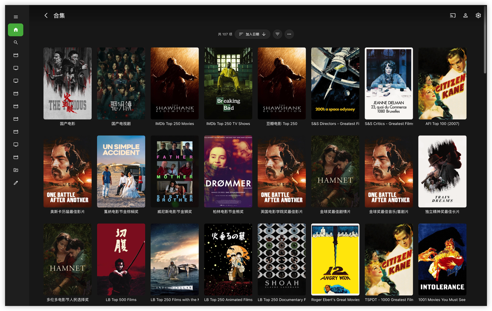

# Emby Collection Sync

[简体中文](README.md) | **繁體中文** | [English](README.en.md)

將 TMDb 榜單同步爲 Emby 合集，支持缺失報告、MoviePilot 自動訂閱、國家/地區影視整理和原語言海報。適用於青龍面板，也可以直接使用 Python 運行。

## 🎬 與 Emby Companion 配合

[Emby Companion](https://github.com/ffinly/emby-companion) 是一款 macOS 觀影助手，支援榜單選片、入庫與缺集核對、手動訂閱，並可呼叫本機播放器觀看。應用程式使用本專案的預置榜單，本腳本負責定時整理 Emby 伺服器端合集；兩者可獨立使用，也可搭配使用。

## ✨ 核心特性

- **🏆 榜單自動同步**：內建 157 個 IMDb、豆瓣、Letterboxd、TMDb 等榜單，支援新增自己的 TMDb 清單、同步簡介並報告缺失影片。
- **📌 每日重建置頂**：保留建立順序，在 Emby 按新增日期降序排列時，讓本次產生的合集排在其他舊合集前面；完成並驗證新合集後再刪除舊合集。
- **🌏 國家／地區合集**：預設 `CN` 合併中國大陸、香港、臺灣、澳門；可增加其他代碼，不寫 `CN` 則不產生國產合集，留空則關閉國家合集。
- **🌐 單檔與三語支援**：只需部署 `emby_collection_sync.py`；常用參數在最前面，內建簡體中文、繁體中文和英文日誌、通知及榜單名稱。
- **⭐ 收藏例外使用者名稱**：預設自動收藏，可按 Emby 使用者名稱設定例外，也可以關閉自動收藏。
- **🍿 MoviePilot 自動訂閱**：支援全量、前 N 名、僅報告三種榜單策略；電影與劇集分別排除，電視劇按季檢查訂閱。
- **🖼️ 海報與執行報告**：原語言海報、缺主封面修復、缺失詳情、訂閱與修復統計；提供快取、分頁驗證、連線設定檢查和日誌金鑰遮蔽。

## 📸 運行效果展示



*Emby 合集海報牆與分類展示。*

## 🚀 快速開始 (以青龍面板為例)

需要 **Python 3.9+**、可訪問的 Emby 服務器和 TMDb API Key。MoviePilot 爲可選功能。

1. 把 [emby_collection_sync.py](emby_collection_sync.py) 放入青龍 `scripts` 目錄；無需額外的 Python 設定檔。
2. 在青龍「依賴管理 → Python3」安裝 `requests`、`urllib3`。
3. 在青龍「環境變數」新增 `EMBY_URL`、`EMBY_API_KEY`、`TMDB_API_KEY`；填寫方式與可選變數見[連線設定](#連線設定預設讀取環境變數)。
4. 修改腳本頂部的語言、國家碼、收藏例外等參數，以及下方榜單的訂閱策略；同步邏輯無需修改。
5. 執行 `task emby_collection_sync.py`，直接同步合集並按配置處理收藏、訂閱與通知。
6. 每天執行一次即可。標準五段 cron 示例：`30 8 * * *`（每天 08:30）；如果你的面板使用含秒的六段格式，則爲 `0 30 8 * * *`。時間以面板配置的時區爲準。

青龍通知沿用 `notify.send`，在面板通知設置中配置渠道即可；沒有 `notify` 模塊時只在控制檯輸出，不要求安裝同名第三方包。

### 腳本結構與多語言設定

| 腳本區域 | 內容 |
| --- | --- |
| 頂部常用參數 | 語言、國家碼、收藏例外、連線資訊、代理和海報策略 |
| 榜單設定 | 核心榜單、豆瓣分類、歷史名稱對照與圖示 |
| 多語言資料 | 榜單譯名、日誌與通知文案、國家／地區名稱 |
| 同步邏輯 | API 請求、每日重建、訂閱、收藏與通知 |

腳本前面放常用參數，後面依序放榜單、翻譯和同步邏輯。`LIST_NAMES` 按榜單 ID 設定 `zh-CN`、`zh-TW`、`en` 名稱；`MESSAGES` 以英文為鍵，按 `zh-CN`、`zh-TW`、`en` 保存日誌和通知文案；`COUNTRY_LABELS` 設定國家／地區的三語名稱，`COUNTRY_ALIASES` 補充別名，`COUNTRY_LEGACY_LABELS` 保留舊譯名供合集更名比對。修改文案時保留 `{name}` 等佔位符。只需要切換語言時，改 `LANGUAGE` 即可。

腳本頂部說明和設定註解提供三語；同步邏輯使用英文程式碼和註解，實際顯示文案從內建三語表讀取。

只需為 `emby_collection_sync.py` 建立排程。更新腳本前，請備份並合併自己的參數和榜單策略。

### 腳本頂部的常用參數

設定註解同時提供簡體中文、繁體中文和英文；日誌與通知只顯示 `LANGUAGE` 選取的語言。

```python
LANGUAGE = "zh-TW"                    # zh-CN / zh-TW / en；腳本預設為 zh-CN
COUNTRY_CODES = ["CN"]                 # CN 合併大陸、香港、臺灣、澳門；[] 關閉國家合集
FAVORITES_ENABLE = True                # 默認繼續全員自動收藏
FAVORITES_EXCLUDE_USERS = ["kids"]      # 例外：Emby 用戶名，精確匹配、區分大小寫
MP_ENABLE = False                     # 啟用後需設定 MP_URL 和 MP_API_TOKEN
USE_PROXY = False                     # 開啓後還需填寫 PROXY_URL
EMBY_VERIFY_SSL = True                 # 驗證 Emby HTTPS 憑證；自簽憑證可設 False
MP_VERIFY_SSL = True                   # 驗證 MoviePilot HTTPS 憑證；自簽憑證可設 False
LIST_POSTER_MODE = "library"           # library：庫內榜單第一；list：榜單第一
DOMESTIC_POSTER_MODE = "premiere"      # premiere：最新上映；added：最新入庫
POSTER_SIZE = "w780"                   # w780 / original
COUNTRY_CACHE_DAYS = 90                # 產地快取有效天數，必須大於 0
```

上面的 `kids` 是示例，腳本默認例外名單爲空。填寫 **Emby 的實際用戶名**，不是用戶 ID；例外用戶不會被腳本自動添加收藏，也不會主動清除其已有收藏。每日重建會產生新合集 ID，舊合集上的個人收藏狀態不會被遷移。這個設置不是內容訪問控制：兒童賬戶能否看到某個合集，仍需在 Emby 中設置權限。

`LANGUAGE` 同時影響腳本日誌、通知、內置榜單名稱和國家合集名稱。腳本向 TMDb 請求對應語言的標題；實際返回內容取決於 TMDb 是否提供翻譯。自定義榜單名稱保持原樣，第三方 API 返回的錯誤說明也保留原文。

### 連線設定（預設讀取環境變數）

預設讀取環境變數；也可以按腳本設定區的註解範例，替換對應賦值行。手動賦值後該項以填寫的值為準，其他未修改的項目仍讀環境變數。例如腳本中保留的是：

```python
MP_URL = os.getenv("MP_URL")
# MP_URL = "http://192.168.1.10:3000"
MP_API_TOKEN = os.getenv("MP_API_TOKEN")
# MP_API_TOKEN = "your-mp-api-token"
```

以上手動值只是註解，不會預設啟用。Emby、TMDb、MoviePilot、代理和 TMDb v4 token 都提供相同寫法。`EMBY_SYNC_CACHE` 用環境變數指定國家快取路徑。

| 變量 | 必填條件 | 說明 |
| --- | --- | --- |
| `EMBY_URL` | 必填 | Emby 根地址，如 `http://192.168.1.100:8096`，不要再加 `/emby` |
| `EMBY_API_KEY` | 必填 | Emby API Key |
| `TMDB_API_KEY` | 必填 | TMDb v3 API Key |
| `MP_URL` | `MP_ENABLE = True` | MoviePilot 服務地址 |
| `MP_API_TOKEN` | `MP_ENABLE = True` | MoviePilot API Token |
| `PROXY_URL` | `USE_PROXY = True` | TMDb API 和圖片請求使用的 HTTP(S) 代理地址 |
| `TMDB_ACCESS_TOKEN` | 可選 | TMDb API Read Access Token；v3 列表返回 404 時，用它嘗試 v4。私有列表需要有權限的用戶 token |
| `EMBY_SYNC_CACHE` | 可選 | 國家查詢緩存文件的完整路徑，默認放在腳本旁的 `.emby_country_cache.json` |

缺少必填連線設定或參數錯誤時，腳本會在連接服務器之前直接指出問題。HTTPS 默認驗證證書；關閉 Emby 或 MoviePilot 的驗證不會影響 TMDb API 和圖片站的驗證。

### 按國家/地區生成合集

- 預設 `COUNTRY_CODES = ["CN"]`；搭配 `LANGUAGE = "zh-TW"` 時產生「國產電影」「國產電視劇」。**本腳本的 `CN` 是合併分組，包含中國大陸、香港、臺灣、澳門，對應 TMDb 代碼 `CN/HK/TW/MO`**，並非僅比對 TMDb 的單一 `CN` 代碼。
- 不寫 `CN` 就不產生國產合集。例如 `["JP", "US"]` 只產生日本、美國的電影與劇集合集；`[]` 不產生任何國家／地區合集，其他榜單同步照常執行。無需另設開關。
- `HK`、`TW`、`MO` 也可以單獨填寫，產生各自的地區合集；與 `CN` 同時填寫時，相關資源可以同時進入合併合集和獨立地區合集。
- 所有國家／地區合集統一使用 TMDb 國家碼分類：電影讀取 `production_countries`，劇集讀取 `origin_country`，`CN` 電影也遵循此規則。聯合製作可以進入多個合集；這是產地分類，不是對白語言分類。
- 離線內建 272 個國家／地區的完整三語名稱，包含 `SU`（蘇聯）、`XC`（捷克斯洛伐克）等歷史地區。`NZ` 會顯示為「新西兰／紐西蘭／New Zealand」，國家名稱查詢無需額外網路請求。
- 設定支援兩位代碼和已知別名／名稱：`UK` 自動轉為 `GB`，`USA` 轉為 `US`，`USSR` 轉為 `SU`；忽略首尾空格和大小寫，正規化後自動去重。仍建議填寫代碼；填寫中國相關名稱並正規化為 `CN` 時，仍執行前述四地區合併規則。無法識別的設定會在連線前報錯，不進行模糊猜測。
- 更新名稱時會識別舊譯名及舊的代碼式合集名稱，例如將 `NZ電影` 對應到 `紐西蘭電影`，避免正常重建後留下重複合集。
- TMDb 查詢結果預設快取 90 天，可透過 `COUNTRY_CACHE_DAYS` 調整；有效期內直接使用快取，到期後重新查詢。查詢回傳 404（項目不存在）時，僅跳過該項目的國家分類並清除其舊產地快取，繼續處理其他項目，不改動 Emby 媒體庫中的電影或劇集；下次執行會重新嘗試查詢。逾時、限流或其他查詢故障會優先使用歷史快取；沒有可用快取時保留該媒體類型的舊國家合集。缺少 TMDb ID 的項目會記錄並跳過國家分類。

從設定中刪除 `CN`、其他國家碼或榜單，只停止後續產生和重建，不會自動刪除已存在的合集。

### 榜單與 MoviePilot 策略

`emby_collection_sync.py` 中保留 `CUSTOM_LISTS`、`DOUBAN_GENRE_LISTS`、`DOUBAN_TV_LISTS` 三組設定。可以刪除不需要的條目，也可以添加自己的 TMDb 列表，不限於下方公開榜單。將項目加入對應陣列中；`id` 填寫 TMDb 列表網址 `/list/` 後的數字，不要填寫完整網址。以下 `123456` 僅為格式範例，請替換成自己的列表 ID：

```python
{"name": "我的片單", "id": "123456", "type": "Movie",
 "mp_subscribe": 3, "notify_missing": True}
```

`type` 爲 `Movie` 或 `Series`；不寫時按電影處理。`mp_subscribe` 可爲 `True`（缺失即訂閱）、`False`（僅報告）、正整數（只訂閱榜單前 N 名中的缺失項目，填 `0` 等同 `False`）。只有 `MP_ENABLE = True` 時才真正提交訂閱。`notify_missing` 控制核心榜單的缺失詳情；分類榜單沿用精簡統計。

電影、劇集排除列表分別配置在 `MP_EXCLUDE_MOVIE_IDS`、`MP_EXCLUDE_SERIES_IDS`，數字和字符串 ID 均可。電視劇繼續按季檢查和訂閱，季 0 表示特別篇。防重查詢失敗時停止對應訂閱流程，避免把錯誤響應當成“尚未訂閱”。

## 📌 每日重建與排序

按「豆瓣分類 → 核心榜單 → 國家合集」順序執行。豆瓣分類與核心榜單分別倒序建立；國家合集先處理劇集、再處理電影，每種媒體類型內按國家碼設定倒序建立，讓靠前的設定項較晚建立。因此在 Emby 選擇 **添加日期降序**，本次新建的這一組合集會排在其他舊合集前面。之後若有其他新合集創建，下次運行會再次置頂。

重建時先創建臨時合集，分批添加並校驗全部條目、寫入正式名稱，再刪除舊合集。創建、添加或校驗失敗時保留舊合集。每次成功重建都會產生新的合集 ID，並按設定重新產生海報。

**同步目標按設定名稱及歷史名稱比對**。請把配置中的名稱留給腳本使用：手工創建的同名合集也會被視爲同步目標。切換語言時會識別內置榜單的舊語言名稱，避免正常切換後留下重複合集。不同時運行兩個同步任務；若任務被強制中斷，可能留下名稱含 `[sync-...]` 的臨時合集，可確認後手工刪除。

榜單拉取失敗或分頁不完整時不會重建該合集，也不會按殘缺榜單提交訂閱；空榜單或匹配不足兩部時保留原合集。國家合集至少比對到一部才重建。比對數量只決定是否重建合集，不影響完整榜單中缺失項目的訂閱策略。其他不同名合集不會參與重建，但「缺封面修復」步驟仍會檢查它們。

## 🖼️ 海報與報告

榜單合集海報按榜單第一或庫內第一選擇；國家合集按最新上映或入庫排序，使用首個能取得海報的項目。合集優先使用原語言海報，沒有時可使用 TMDb 的其他可用海報。缺主封面的電影和劇集僅使用原語言海報，不覆蓋已有主封面。海報任務在主流程之後**順序執行**，不是異步併發。

默認下載 `w780` 海報以減少流量，可改回 `original`。上傳新圖前保留舊圖。通知包含核心榜單明細、分類概覽、缺失前 3 項、訂閱和封面修復統計，並顯示失敗/跳過的合集。分類概覽統計比對達標的合集數量，不代表成功重建數量；重建失敗會另行列出。

## 🐍 不使用青龍時運行

將 [emby_collection_sync.py](emby_collection_sync.py) 和 [requirements.txt](requirements.txt) 下載到同一目錄，在終端機進入該目錄後執行以下命令（Linux/macOS）：

```bash
python3 -m venv .venv
source .venv/bin/activate
python3 -m pip install -r requirements.txt
export EMBY_URL="http://192.168.1.100:8096"
export EMBY_API_KEY="你的Emby密鑰"
export TMDB_API_KEY="你的TMDb密鑰"
python3 emby_collection_sync.py
```

定時運行時，在自己的任務環境中提供這些變量，並使用虛擬環境的 Python 完整路徑。日誌會對密鑰和 URL 中的認證信息脫敏；手動填寫的實際金鑰請保留在自己的腳本副本中。

## 🔗 線上公開最新榜單列表

以下 TMDB 列表完全由自動化爬蟲與 ETL 流水線自動維護。**系統會在每天早上 7:30 (UTC+8) 定時執行數據抓取、比對與同步更新**，確保榜單排名與官方時刻保持一致。

### 🏆 第一梯隊：大眾必看

* 🍿 **IMDb Top 250 Movies**: [查看網格牆視圖](https://www.themoviedb.org/list/8647021?view=grid)
* 📺 **IMDb Top 250 TV Shows**: [查看網格牆視圖](https://www.themoviedb.org/list/8647022?view=grid)
* 🎞️ **豆瓣電影 Top 250**: [查看網格牆視圖](https://www.themoviedb.org/list/8647023?view=grid)

### 🏛️ 第二梯隊：影史殿堂

* 🏛️ **S&S Directors - Greatest Films**: [查看網格牆視圖](https://www.themoviedb.org/list/8649058?view=grid)
* 🏛️ **S&S Critics - Greatest Films**: [查看網格牆視圖](https://www.themoviedb.org/list/8649050?view=grid)
* ⭐ **AFI Top 100 (2007)**: [查看網格牆視圖](https://www.themoviedb.org/list/8649041?view=grid)
* 🎓 **Harvard Film PhD Program**: [查看網格牆視圖](https://www.themoviedb.org/list/8714340?view=grid)
* 📰 **NYT - 100 Best Movies of the 21st Century (2025)**: [查看網格牆視圖](https://www.themoviedb.org/list/8701141?view=grid)
* 📡 **NYT - 100 Best TV Shows of the 21st Century (2026)**: [查看網格牆視圖](https://www.themoviedb.org/list/8701142?view=grid)

### 🌍 第三梯隊：全球最具含金量大獎矩陣

* 🏆 **奧斯卡歷屆最佳影片**: [查看網格牆視圖](https://www.themoviedb.org/list/8648843?view=grid)
* 🌿 **戛納電影節金棕櫚獎**: [查看網格牆視圖](https://www.themoviedb.org/list/8648844?view=grid)
* 🦁 **威尼斯電影節金獅獎**: [查看網格牆視圖](https://www.themoviedb.org/list/8648854?view=grid)
* 🐻 **柏林電影節金熊獎**: [查看網格牆視圖](https://www.themoviedb.org/list/8648852?view=grid)
* 🎭 **英國電影學院獎最佳影片**: [查看網格牆視圖](https://www.themoviedb.org/list/8648848?view=grid)
* 🌐 **金球獎最佳劇情片**: [查看網格牆視圖](https://www.themoviedb.org/list/8648849?view=grid)
* 🥂 **金球獎最佳音樂/喜劇片**: [查看網格牆視圖](https://www.themoviedb.org/list/8648850?view=grid)
* 🍁 **多倫多電影節人民選擇獎**: [查看網格牆視圖](https://www.themoviedb.org/list/8648855?view=grid)
* 🕊️ **獨立精神獎最佳長片**: [查看網格牆視圖](https://www.themoviedb.org/list/8648851?view=grid)

### 🎬 第四梯隊：高階影迷社區與名家策展

* 🎬 **LB Top 500 Films**: [查看網格牆視圖](https://www.themoviedb.org/list/8648802?view=grid)
* 🔥 **LB Top 250 Films with the Most Fans**: [查看網格牆視圖](https://www.themoviedb.org/list/8649224?view=grid)
* 💥 **LB Top 250 Action Films**: [查看網格牆視圖](https://www.themoviedb.org/list/8714314?view=grid)
* 🎨 **LB Top 250 Animated Films**: [查看網格牆視圖](https://www.themoviedb.org/list/8649225?view=grid)
* 📖 **LB Top 250 Biographical Films**: [查看網格牆視圖](https://www.themoviedb.org/list/8714315?view=grid)
* 🚔 **LB Top 250 Crime Films**: [查看網格牆視圖](https://www.themoviedb.org/list/8714316?view=grid)
* 📽️ **LB Top 250 Documentary Films**: [查看網格牆視圖](https://www.themoviedb.org/list/8649231?view=grid)
* 🌑 **LB Top 100 Film Noir Films**: [查看網格牆視圖](https://www.themoviedb.org/list/8714317?view=grid)
* 👻 **LB Top 250 Horror Films**: [查看網格牆視圖](https://www.themoviedb.org/list/8714318?view=grid)
* 🧙 **LB Top 100 Live-Action Fantasy Films**: [查看網格牆視圖](https://www.themoviedb.org/list/8714319?view=grid)
* 💃 **LB Top 250 Musical Films**: [查看網格牆視圖](https://www.themoviedb.org/list/8714320?view=grid)
* 🔍 **LB Top 250 Mystery Films**: [查看網格牆視圖](https://www.themoviedb.org/list/8714322?view=grid)
* 💕 **LB Top 250 Romantic Comedy Films**: [查看網格牆視圖](https://www.themoviedb.org/list/8714328?view=grid)
* 🚀 **LB Top 250 Science Fiction Films**: [查看網格牆視圖](https://www.themoviedb.org/list/8714330?view=grid)
* 🏃 **LB Top 100 Sports Films**: [查看網格牆視圖](https://www.themoviedb.org/list/8714333?view=grid)
* ⚔️ **LB Top 250 War Films**: [查看網格牆視圖](https://www.themoviedb.org/list/8714334?view=grid)
* 🤠 **LB Top 100 Western Films**: [查看網格牆視圖](https://www.themoviedb.org/list/8714335?view=grid)
* 📝 **Roger Ebert's Great Movies**: [查看網格牆視圖](https://www.themoviedb.org/list/8649219?view=grid)

### 📚 第五梯隊：超大體量洗版底倉

* 🎥 **TSPDT - 1000 Greatest Films**: [查看網格牆視圖](https://www.themoviedb.org/list/8648821?view=grid)
* 📖 **1001 Movies You Must See Before You Die**: [查看網格牆視圖](https://www.themoviedb.org/list/8649029?view=grid)
* 💽 **Criterion Collection**: [查看網格牆視圖](https://www.themoviedb.org/list/8649108?view=grid)

### ✨ 第六梯隊：現代獨立與流行廠牌

* ✨ **Every A24 Film**: [查看網格牆視圖](https://www.themoviedb.org/list/8649217?view=grid)
* 🔴 **Every NEON Film**: [查看網格牆視圖](https://www.themoviedb.org/list/8649218?view=grid)
* 🎟️ **Every MUBI Film**: [查看網格牆視圖](https://www.themoviedb.org/list/8649220?view=grid)

### 📈 第七梯隊：實時口碑與趨勢榜

* 📈 **豆瓣 - 一週口碑電影榜**: [查看網格牆視圖](https://www.themoviedb.org/list/8648547?view=grid)
* 📺 **豆瓣 - 華語口碑劇集榜**: [查看網格牆視圖](https://www.themoviedb.org/list/8648548?view=grid)
* 🌍 **豆瓣 - 全球口碑劇集榜**: [查看網格牆視圖](https://www.themoviedb.org/list/8648549?view=grid)
* 🔥 **豆瓣 - 實時熱門電影榜**: [查看網格牆視圖](https://www.themoviedb.org/list/8648550?view=grid)
* 🔥 **豆瓣 - 實時熱門電視榜**: [查看網格牆視圖](https://www.themoviedb.org/list/8648551?view=grid)
* 📈 **TMDB - 熱門電影榜**: [查看網格牆視圖](https://www.themoviedb.org/list/8706223?view=grid)
* 📺 **TMDB - 熱門劇集榜**: [查看網格牆視圖](https://www.themoviedb.org/list/8706224?view=grid)
* 🔥 **TMDB - 本週趨勢電影榜**: [查看網格牆視圖](https://www.themoviedb.org/list/8706225?view=grid)
* 🔥 **TMDB - 本週趨勢劇集榜**: [查看網格牆視圖](https://www.themoviedb.org/list/8706226?view=grid)

### 📂 豆瓣電影 28 大分類多維度榜單

* 🎭 **劇情**: [Top 20](https://www.themoviedb.org/list/8647681?view=grid) | [高分經典](https://www.themoviedb.org/list/8648565?view=grid)
* 😂 **喜劇**: [近期熱門](https://www.themoviedb.org/list/8648552?view=grid) | [Top 20](https://www.themoviedb.org/list/8647682?view=grid) | [高分經典](https://www.themoviedb.org/list/8648566?view=grid) | [冷門佳作](https://www.themoviedb.org/list/8648595?view=grid)
* 💥 **動作**: [近期熱門](https://www.themoviedb.org/list/8648555?view=grid) | [Top 20](https://www.themoviedb.org/list/8647683?view=grid) | [高分經典](https://www.themoviedb.org/list/8648568?view=grid) | [冷門佳作](https://www.themoviedb.org/list/8648597?view=grid)
* ❤️ **愛情**: [近期熱門](https://www.themoviedb.org/list/8648553?view=grid) | [Top 20](https://www.themoviedb.org/list/8647684?view=grid) | [高分經典](https://www.themoviedb.org/list/8648567?view=grid) | [冷門佳作](https://www.themoviedb.org/list/8648596?view=grid)
* 🚀 **科幻**: [近期熱門](https://www.themoviedb.org/list/8648556?view=grid) | [Top 20](https://www.themoviedb.org/list/8647685?view=grid) | [高分經典](https://www.themoviedb.org/list/8648570?view=grid) | [冷門佳作](https://www.themoviedb.org/list/8648598?view=grid)
* 🎨 **動畫**: [近期熱門](https://www.themoviedb.org/list/8648557?view=grid) | [Top 20](https://www.themoviedb.org/list/8647686?view=grid) | [高分經典](https://www.themoviedb.org/list/8648571?view=grid) | [冷門佳作](https://www.themoviedb.org/list/8648599?view=grid)
* 🔍 **懸疑**: [近期熱門](https://www.themoviedb.org/list/8648558?view=grid) | [Top 20](https://www.themoviedb.org/list/8647687?view=grid) | [高分經典](https://www.themoviedb.org/list/8648572?view=grid) | [冷門佳作](https://www.themoviedb.org/list/8648600?view=grid)
* 😱 **驚悚**: [近期熱門](https://www.themoviedb.org/list/8648560?view=grid) | [Top 20](https://www.themoviedb.org/list/8647688?view=grid) | [高分經典](https://www.themoviedb.org/list/8648574?view=grid) | [冷門佳作](https://www.themoviedb.org/list/8648602?view=grid)
* 👻 **恐怖**: [近期熱門](https://www.themoviedb.org/list/8648562?view=grid) | [Top 20](https://www.themoviedb.org/list/8647689?view=grid) | [高分經典](https://www.themoviedb.org/list/8648581?view=grid) | [冷門佳作](https://www.themoviedb.org/list/8648607?view=grid)
* 📽️ **紀錄片**: [Top 20](https://www.themoviedb.org/list/8647690?view=grid)
* ⏱️ **短片**: [Top 20](https://www.themoviedb.org/list/8647691?view=grid)
* 🔞 **情色**: [Top 20](https://www.themoviedb.org/list/8647692?view=grid) | [高分經典](https://www.themoviedb.org/list/8648586?view=grid) | [冷門佳作](https://www.themoviedb.org/list/8648612?view=grid)
* 🎵 **音樂**: [Top 20](https://www.themoviedb.org/list/8647693?view=grid) | [高分經典](https://www.themoviedb.org/list/8648578?view=grid) | [冷門佳作](https://www.themoviedb.org/list/8648604?view=grid)
* 💃 **歌舞**: [Top 20](https://www.themoviedb.org/list/8647694?view=grid) | [高分經典](https://www.themoviedb.org/list/8648584?view=grid) | [冷門佳作](https://www.themoviedb.org/list/8648610?view=grid)
* 🏠 **家庭**: [Top 20](https://www.themoviedb.org/list/8647695?view=grid) | [高分經典](https://www.themoviedb.org/list/8648576?view=grid)
* 👶 **兒童**: [Top 20](https://www.themoviedb.org/list/8647696?view=grid) | [高分經典](https://www.themoviedb.org/list/8648577?view=grid)
* 📖 **傳記**: [近期熱門](https://www.themoviedb.org/list/8648564?view=grid) | [Top 20](https://www.themoviedb.org/list/8647697?view=grid) | [高分經典](https://www.themoviedb.org/list/8648583?view=grid) | [冷門佳作](https://www.themoviedb.org/list/8648609?view=grid)
* 📜 **歷史**: [Top 20](https://www.themoviedb.org/list/8647698?view=grid) | [高分經典](https://www.themoviedb.org/list/8648579?view=grid) | [冷門佳作](https://www.themoviedb.org/list/8648605?view=grid)
* ⚔️ **戰爭**: [近期熱門](https://www.themoviedb.org/list/8648563?view=grid) | [Top 20](https://www.themoviedb.org/list/8647699?view=grid) | [高分經典](https://www.themoviedb.org/list/8648582?view=grid) | [冷門佳作](https://www.themoviedb.org/list/8648608?view=grid)
* 🚔 **犯罪**: [近期熱門](https://www.themoviedb.org/list/8648559?view=grid) | [Top 20](https://www.themoviedb.org/list/8647700?view=grid) | [高分經典](https://www.themoviedb.org/list/8648573?view=grid) | [冷門佳作](https://www.themoviedb.org/list/8648601?view=grid)
* 🤠 **西部**: [Top 20](https://www.themoviedb.org/list/8647702?view=grid) | [高分經典](https://www.themoviedb.org/list/8648588?view=grid)
* 🧙 **奇幻**: [Top 20](https://www.themoviedb.org/list/8647703?view=grid) | [高分經典](https://www.themoviedb.org/list/8648580?view=grid) | [冷門佳作](https://www.themoviedb.org/list/8648606?view=grid)
* 🗺️ **冒險**: [近期熱門](https://www.themoviedb.org/list/8648561?view=grid) | [Top 20](https://www.themoviedb.org/list/8647704?view=grid) | [高分經典](https://www.themoviedb.org/list/8648575?view=grid) | [冷門佳作](https://www.themoviedb.org/list/8648603?view=grid)
* 🌋 **災難**: [Top 20](https://www.themoviedb.org/list/8647705?view=grid) | [高分經典](https://www.themoviedb.org/list/8648587?view=grid) | [冷門佳作](https://www.themoviedb.org/list/8648613?view=grid)
* 🥋 **武俠**: [Top 20](https://www.themoviedb.org/list/8647706?view=grid) | [高分經典](https://www.themoviedb.org/list/8648585?view=grid) | [冷門佳作](https://www.themoviedb.org/list/8648611?view=grid)
* 🏮 **古裝**: [Top 20](https://www.themoviedb.org/list/8647707?view=grid) | [高分經典](https://www.themoviedb.org/list/8648593?view=grid)
* 🏃 **運動**: [Top 20](https://www.themoviedb.org/list/8647708?view=grid) | [高分經典](https://www.themoviedb.org/list/8648594?view=grid)
* 🌑 **黑色電影**: [Top 20](https://www.themoviedb.org/list/8647709?view=grid)

### 📺 豆瓣電視劇地區與類型榜單

* 🇨🇳 **大陸劇**: [近期熱門](https://www.themoviedb.org/list/8702683?view=grid) | [高分經典](https://www.themoviedb.org/list/8702684?view=grid) | [冷門佳作](https://www.themoviedb.org/list/8702685?view=grid)
* 🇺🇸 **美劇**: [近期熱門](https://www.themoviedb.org/list/8702686?view=grid) | [高分經典](https://www.themoviedb.org/list/8702687?view=grid) | [冷門佳作](https://www.themoviedb.org/list/8702688?view=grid)
* 🇬🇧 **英劇**: [高分經典](https://www.themoviedb.org/list/8702689?view=grid) | [冷門佳作](https://www.themoviedb.org/list/8702690?view=grid)
* 🇯🇵 **日劇**: [近期熱門](https://www.themoviedb.org/list/8702691?view=grid) | [高分經典](https://www.themoviedb.org/list/8702692?view=grid) | [冷門佳作](https://www.themoviedb.org/list/8702693?view=grid)
* 🇰🇷 **韓劇**: [近期熱門](https://www.themoviedb.org/list/8702694?view=grid) | [高分經典](https://www.themoviedb.org/list/8702695?view=grid) | [冷門佳作](https://www.themoviedb.org/list/8702696?view=grid)
* 🇭🇰 **港劇**: [高分經典](https://www.themoviedb.org/list/8702697?view=grid) | [冷門佳作](https://www.themoviedb.org/list/8702698?view=grid)
* 🇨🇳 **臺劇**: [高分經典](https://www.themoviedb.org/list/8702699?view=grid) | [冷門佳作](https://www.themoviedb.org/list/8702700?view=grid)
* 🇹🇭 **泰劇**: [冷門佳作](https://www.themoviedb.org/list/8702701?view=grid)
* 🇪🇺 **歐洲劇**: [近期熱門](https://www.themoviedb.org/list/8702702?view=grid) | [高分經典](https://www.themoviedb.org/list/8702703?view=grid)
* 🎨 **動畫劇集**: [高分經典](https://www.themoviedb.org/list/8702704?view=grid)

## 📈 Star History

<a href="https://www.star-history.com/?repos=ffinly%2Femby-collection-sync&amp;type=date&amp;legend=top-left">
  <picture>
    <source media="(prefers-color-scheme: dark)" srcset="https://api.star-history.com/chart?repos=ffinly/emby-collection-sync&amp;type=date&amp;theme=dark&amp;legend=top-left" />
    <source media="(prefers-color-scheme: light)" srcset="https://api.star-history.com/chart?repos=ffinly/emby-collection-sync&amp;type=date&amp;legend=top-left" />
    
  </picture>
</a>

## 📄 License

本項目基於 [GPL-3.0 license](LICENSE) 協議開源 - 詳情請查看 LICENSE 文件。
